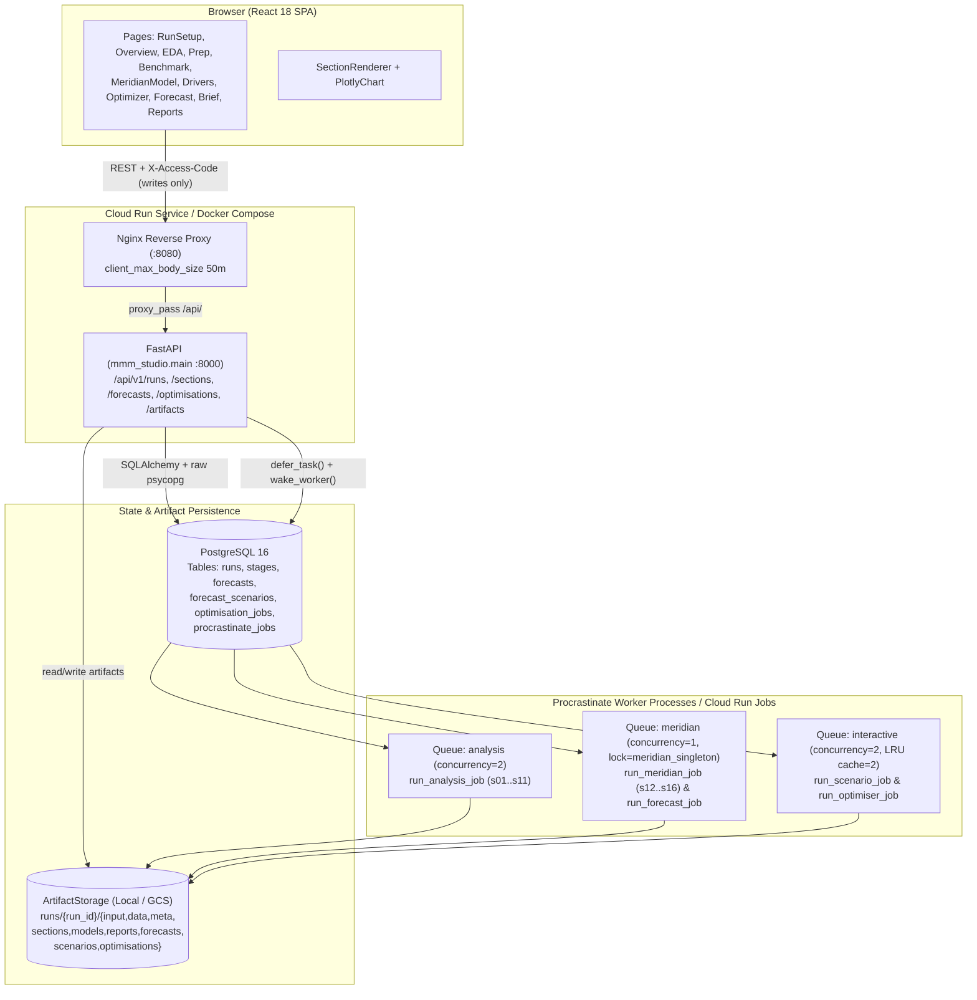

# Architecture Review: MMM Studio & Google Meridian 2.1.0 Integration

Audit date: 2026-11-03. Audited commit: `ace6bb0` (`main` branch, clean working tree).
No application code was modified during this audit.

---

## 1. System Overview & Architectural Boundaries

MMM Studio (`src/app/`) is a full-stack web application wrapping **Google Meridian 2.1.0** (`google-meridian[schema]==2.1.0`). It allows marketing analysts and decision-makers to upload a multi-channel daily marketing workbook (`.xlsx`), configure channel roles and Bayesian MMM hyperparameters, execute an automated 16-stage analytical and MCMC modelling pipeline, inspect diagnostic and executive report sections, run constrained budget optimisations, and evaluate forward budget plans and multiplier scenarios.

The repository contains two distinct implementations of the Tchibo MMM workflow:
1. **Frozen Reference Package (`src/tchibo_mmm/` and `notebooks/01–05`)**: The original case-study research code.
2. **Production Web Application (`src/app/backend/mmm_studio/` and `src/app/frontend/`)**: A self-contained FastAPI + React + PostgreSQL + Procrastinate application that re-implements the domain pipeline without importing `tchibo_mmm` (enforced by architectural contract in `src/app/CLAUDE.md`).

---

## 2. Technology Stack & Exact Dependency Versions

Verified directly from `src/app/backend/pyproject.toml`, `src/app/backend/.venv`, and `src/app/frontend/package.json`:

| Layer | Package / Component | Installed Version | Role |
|---|---|---|---|
| **Bayesian MMM** | `google-meridian[schema]` | `2.1.0` (pinned `==2.1.0`) | Hierarchical/national Bayesian MMM, NUTS sampler, `Analyzer`, `BudgetOptimizer`, protobuf serde |
| **Probabilistic / ML** | `tensorflow` / `tf-keras` | `2.21.0` / `2.21.0` | Tensor compute graph and XLA compilation for TensorFlow Probability NUTS |
| | `jax` / `jaxlib` | `0.12.0.1` | Numerical backend dependency bundled with Meridian 2.1.0 |
| | `arviz` / `xarray` | `0.19.0` / `2026.9.0` | `InferenceData` posterior container (`prior`, `posterior`, `sample_stats`) and $\hat{R}$/ESS diagnostics |
| **Scientific Stack** | `numpy` / `pandas` / `scipy` | `2.3.5` / `2.3.3` / `1.18.1` | Panel construction, PCHIP response-curve interpolation, SLSQP constrained optimisation |
| | `statsmodels` / `scikit-learn` | `0.14.x` / `>=1.5` | OLS ladder, Newey-West HAC standard errors, VIF, walk-forward cross-validation |
| | `holidays` / `openpyxl` | `>=0.58` / `>=3.1.5` | German federal/state holiday calendar (`DE`), Excel `.xlsx` ingestion |
| **Backend API & DB** | `fastapi` / `uvicorn` | `0.162.0` / `0.30.x` | REST API server and ASGI runner |
| | `pydantic` / `pydantic-settings` | `2.14.2` / `>=2.5` | Request/response validation and `MMM_`-prefixed environment settings |
| | `sqlalchemy` / `psycopg[binary]` | `2.1.6` / `>=3.2` | ORM (`DeclarativeBase`, `create_all`) and PostgreSQL driver |
| **Job Queue** | `procrastinate` | `3.10.0` | PostgreSQL-backed asynchronous task queue (`analysis`, `meridian`, `interactive` queues) |
| **Storage** | `google-cloud-storage` | `>=2.18` | Dual-backend `ArtifactStorage` (`local` filesystem or `gcs` bucket) |
| **Frontend SPA** | `react` / `react-dom` | `18.3.1` | Single-page application UI |
| | `@mui/material` | `5.16.7` | Component library and design system (`theme.ts`) |
| | `@tanstack/react-query` | `5.56.2` | Polling (`2.5s` while active), caching, and mutations |
| | `react-router-dom` | `6.26.2` | Client-side routing across 13 run sub-routes |
| | `plotly.js-cartesian-dist-min` | `2.35.0` | Interactive charts rendered from backend `ChartSpec` JSON payloads |
| **Deployment** | Docker / Nginx / Cloud Run | — | Multi-container Cloud Run Service (`nginx` + `api`) + 3 Cloud Run Jobs (`worker-*`) + Cloud SQL + GCS |

---

## 3. High-Level Architecture & Data Flow

---

## 4. Complete Module Inventory & Responsibilities

### 4.1 Backend (`src/app/backend/mmm_studio/`)

| Module Path | Key Classes / Functions | Responsibility |
|---|---|---|
| `main.py` | `create_app`, `lifespan` | Initialises DB tables (`init_db`), applies Procrastinate schema (`ensure_procrastinate_schema`), mounts CORS and `/api/v1` router. |
| `settings.py` | `AppSettings`, `get_settings` | Loads `MMM_*` env vars: DB URL, storage backend, upload caps (`50 MB`, `250k` rows), sampling profile, access code, queue limits, Cloud Run Job config. |
| `storage.py` | `ArtifactStorage` | Abstracts `local` filesystem and `gcs` bucket I/O (`write_bytes`, `write_json`, `write_parquet`, `read_*`, `list_keys`, `delete_prefix`) with path-traversal protection (`_safe_rel`). |
| `cli.py` | `run_pipeline`, `main` | Offline CLI runner that executes the full pipeline against `data/raw/Data_Case_Study.xlsx` into local storage without Postgres. |
| `db/models.py` | `Run`, `Stage`, `Forecast`, `ForecastScenario`, `OptimisationJob` | SQLAlchemy 2.0 ORM models. Uses `Base.metadata.create_all()` with no Alembic migration history (`AR-05`). |
| `db/session.py` | `get_engine`, `get_session`, `init_db` | Pooled SQLAlchemy engine (`pool_size=5`, `max_overflow=10`, `pool_pre_ping=True`). |
| `core/workbook.py` | `validate_upload_bytes`, `read_raw_dataframe`, `profile_workbook` | Validates `.xlsx` magic bytes and zip header sizes, parses raw rows, infers column mapping and channel roles, emits `WorkbookProfile`. |
| `core/schema.py` | `ColumnMapping`, `ChannelConfig`, `DataRoleConfig`, `WorkbookProfile`, `infer_channel_configs` | Defines canonical channel roles (`paid`, `print_event`, `commission`, `control`, `unpaid`, `ignored`), slug normalisation, and heuristic channel classification. |
| `core/model_settings.py` | `ModelSettings`, `SamplingSettings`, `sampling_for`, `settings_changes` | Validated Pydantic model for hold-out length, catalog shift, adstock shape, `max_lag`, Fourier order, trend, knots/AKS, saturation, ROI priors, and MCMC chain/draw counts. |
| `core/tables.py` | `build_daily_wide_table`, `build_modelling_panel` | Pivots long rows (`aggfunc="sum"`) onto a complete daily `DatetimeIndex`, zero-fills missing channel-days, creates `missing_<slug>` flags, and adds calendar/naive columns. |
| `core/calendar.py` | `german_holidays_flag`, `add_calendar_columns`, `add_naive_baselines`, `HOLDOUT_Q4_2024`, `HOLDOUT_Q3_2024` | Computes German federal/state holiday flags, Christmas (`Dec 10–23`), Black Week (`Nov 22–Dec 2`), and 7-day / 364-day naive baselines. |
| `core/features.py` | `add_calendar_and_adstock_features`, `geometric_adstock`, `binomial_adstock`, `shift_series` | Generates yearly Fourier pairs, normalised linear `trend`, catalog in-home shift + adstock, and log-cost transforms for EDA/OLS. |
| `core/metrics.py` | `compute_forecast_metrics`, `ForecastMetrics` | Computes MAE, RMSE, $R^2$, MAPE (with `1.0` denominator floor), `mae_over_mean` (wMAPE), and signed `bias`. |
| `core/preparation.py` | `fit_ols_Step`, `compute_channel_importance`, `compute_vif_table`, `build_preparation_section` | Fits the 6-step OLS specification ladder (`M0`–`M5`) with Newey-West HAC (`maxlags=14`) errors and VIF diagnostics. |
| `core/ols.py` | `fit_ols_benchmark`, `walk_forward_cv`, `build_benchmark_section` | Evaluates 4-model benchmark (`7-day MA`, `Seasonal naive`, `OLS-1 log-cost`, `OLS-2 Meridian inputs`) on primary/forward hold-outs and 4-fold walk-forward CV. |
| `core/eda/*.py` | `quality.py`, `target.py`, `channels.py`, `spend.py`, `efficiency.py`, `correlations.py`, `catalog.py`, `readiness.py`, `notebook_stats.py` | Builds 8 EDA report sections (`s02`–`s09`) covering missingness, structural breaks (`2024-02-01`, `2024-08-01`), attributed ROAS, correlations, and catalog decay. |
| `core/meridian/spec.py` | `MeridianSpecConfig`, `build_meridian_table`, `build_input_data`, `build_meridian_model`, `save_meridian_model`, `load_meridian_model` | Translates `DataRoleConfig` + `ModelSettings` into Meridian's `DataFrameInputDataBuilder`, `PriorDistribution`, `HoldoutSpec`, `ModelSpec`, and `Meridian` instances. |
| `core/meridian/fit.py` | `fit_meridian`, `fit_meridian_isolated`, `FitCancelledError` | Runs `mmm.sample_prior()` and `mmm.sample_posterior()`. `fit_meridian_isolated` runs MCMC in a `multiprocessing.get_context("spawn")` child process with cancellation polling and hard timeout (`2700s`). |
| `core/meridian/analysis.py` | `extract_expected_vs_actual`, `extract_roi_summary`, `extract_rhat_summary`, `extract_adstock_decay`, `extract_response_curves`, `build_meridian_model_section`, `build_drivers_section`, `build_backtest_card` | Extracts posterior summaries via `meridian.analysis.analyzer.Analyzer` and `ModelReviewer`, and builds the `meridian_model` and `drivers_roi` sections. |
| `core/meridian/selection.py` | `run_specification_selection`, `run_sensitivity_grid`, `build_selection_and_sensitivity_blocks` | Runs the `catalog_shift × affiliate_role` selection grid and 5-variant prior/SEA sensitivity grid (`s16`, full profile only). |
| `core/meridian/optimise.py` | `run_meridian_budget_optimiser`, `optimise_hill_response_curves`, `run_constrained_optimisation`, `build_optimiser_section` | Runs Meridian's native `BudgetOptimizer` for the default report section and a custom PCHIP + SLSQP solver for interactive user requests. |
| `core/meridian/forecast.py` | `load_budget_plan`, `validate_plan`, `extend_history`, `forecast_budget_plan`, `evaluate_forecast_scenario`, `build_forecast_section`, `build_forecast_Job_response` | Appends future budget-plan rows as a hold-out window, refits Meridian, draws posterior predictive trajectories, and evaluates fast `DataTensors` multiplier scenarios. |
| `pipeline/context.py` | `PipelineContext` | Wraps run storage paths (`data/`, `meta/`, `sections/`, `models/`, `reports/`, `forecasts/`) and maintains `sections/_index.json`. |
| `pipeline/stages.py` | `run_analysis_stages`, `run_meridian_stages`, `build_overview_section`, `build_brief_section`, `build_reports_section` | Orchestrates stages `s01`–`s16`, records stage timings/errors via callbacks, and synthesises cross-stage summary sections. |
| `jobs/app.py` | `job_app`, `defer_task`, `sweep_stale_runs`, `meridian_queue_load`, `get_queue_info` | Configures Procrastinate queues, enqueues tasks via temporary `sync_psycopg_connector`, sweeps dead workers (`>300s` heartbeat age), and queries queue depth. |
| `jobs/tasks.py` | `execute_analysis_job`, `execute_meridian_job`, `execute_forecast_job`, `execute_scenario_job`, `execute_optimiser_job`, `_HeartbeatThread` | Worker task bodies with 20s heartbeat threads, cancellation checks, and a 2-entry in-process LRU cache (`_INTERACTIVE_CACHE`) for interactive scenarios/optimisations. |
| `jobs/cloud_run.py` | `wake_worker` | Triggers Cloud Run Job executions via Google Cloud Run v2 REST API when tasks are deferred in cloud deployments. |
| `api/*.py` | `router.py`, `deps.py`, `runs.py`, `sections.py`, `forecasts.py`, `optimiser.py`, `exports.py` | FastAPI endpoints for run lifecycle, section retrieval, custom plan forecasts, scenarios, optimisations, and artifact downloads. |
| `report/*.py` & `charts/*.py` | `sections.py`, `narrative.py`, `facts.py`, `meridian_html.py`, `builders.py`, `theme.py` | Defines Pydantic `SectionPayload` schemas (`KPICard`, `Callout`, `NarrativeBlock`, `ChartSpec`, `TableSpec`, `CollapseGroup`), post-processes Meridian HTML reports, and builds Plotly figures. |

### 4.2 Frontend (`src/app/frontend/src/`)

| Path | Responsibility |
|---|---|
| `App.tsx`, `theme.ts` | Configures `QueryClientProvider`, Material UI theme, and React Router routes (`/`, `/new`, `/runs/:runId/*`). |
| `api/client.ts`, `api/hooks.ts`, `api/types.ts` | Typed `fetch` wrapper (attaches `X-Access-Code` from `sessionStorage`), TanStack Query hooks (polls active runs/forecasts/scenarios/optimisations every `2.5s`), and TypeScript interfaces. |
| `components/Layout/AppShell.tsx`, `RunHeader.tsx`, `AccessCodeDialog.tsx` | Left navigation drawer (groups routes into Setup, Executive, Data & EDA, Modelling, Decision tools, Deliverables), top run status bar with queue depth & cancel/re-run controls, and access-code modal. |
| `components/Sections/SectionRenderer.tsx`, `DataTable.tsx`, `ChartCard.tsx`, `KPIGrid.tsx` | Generic renderer for backend `SectionPayload` JSON, including client-side table sorting, pagination, CSV export, and Plotly chart rendering. |
| `pages/Forecast.tsx`, `components/Forecast/*` | Interactive 6-week budget-plan forecaster: channel multiplier sliders (`0×–2×`), scenario history table, daily fan chart, and weekly table. |
| `pages/Optimizer.tsx` | Interactive budget optimiser: total budget input, global min/max multiplier sliders, per-channel bound overrides, Catalog lock toggle, and run history. |
| `pages/RunSetup.tsx`, `components/Import/*` | Drag-and-drop workbook upload, column mapping, channel role configuration, and `ModelSettings` tabs (`ValidationTab`, `MediaAdstockTab`, `BaselineSeasonalityTab`, `PriorsSaturationTab`, `SamplingTab`). |

---

## 5. End-to-End Application Workflow (`s01` → `s16` → Interactive Tools)

1. **Upload (`POST /api/v1/runs`)**:
   - Validates `.xlsx` bytes (`validate_upload_bytes`), parses the first sheet (`read_raw_dataframe`), detects columns (`detect_column_mapping`), infers channel roles (`infer_channel_configs`), profiles data quality (`profile_workbook`), saves `input/workbook.xlsx` and `meta/profile.json`, and creates a `Run(status="draft")` row in Postgres.
2. **Configuration (`PATCH /api/v1/runs/{run_id}`)**:
   - Updates `config.role_config`, `config.model_settings`, `sampling_profile` (`smoke` / `fast` / `full`), `seed`, and `skip_meridian`.
3. **Execution Start (`POST /api/v1/runs/{run_id}/start`)**:
   - Checks `meridian_queue_load` against `max_queued_meridian_runs` (`2`).
   - Pre-creates `Stage` rows (`s01`–`s11`, plus `s12`–`s15` and `s16` when `sampling_profile == "full"`).
   - Defers `run_analysis_job` (queue `analysis`) and `run_meridian_job` (queue `meridian`, lock `meridian_singleton`) simultaneously.
4. **Analysis Stages (`s01`–`s11`, `run_analysis_job`)**:
   - `s01_ingest`: Re-profiles the workbook, builds `wide_full.parquet`, `wide_model.parquet`, and `wide_featured.parquet`, and writes `meta/config.json`.
   - `s02_data_quality` – `s09_eda_readiness`: Generates 8 EDA sections.
   - `s10_preparation`: Runs the M0–M5 OLS ladder, HAC channel importance, and VIF table.
   - `s11_ols_benchmark`: Runs the 4-model benchmark (`meta/ols_summary.json`), writes `data/meridian_Holdout.parquet`, and builds **draft** `overview`, `brief`, and `reports` sections (marked `"Meridian pending"`).
5. **Meridian Stages (`s12`–`s16`, `run_meridian_job`)**:
   - `s12_meridian_fit`: Fits the primary Meridian model (holding out the last `holdout_days` days) in an isolated child process (`fit_meridian_isolated`), draws posterior predictive intervals (`_prediction_draws`), fits a second Meridian model on the forward hold-out window (previous quarter), saves `models/meridian_Holdout.binpb` and `models/meridian_forward.binpb`, and writes `sections/meridian_model.json`.
   - `s13_drivers_roi`: Extracts posterior ROI, contributions, adstock decay, and response curves (`sections/drivers_roi.json`), runs Meridian's native `BudgetOptimizer` (`sections/optimiser.json`), and generates post-processed Meridian HTML reports (`reports/meridian_summary_*.html`, `meridian_optimiser.html`).
   - `s14_forecast`: Runs a leak-free back-test refit (trained only up to the day before the primary hold-out, evaluated on actual hold-out spend), builds a synthetic 42-day future budget plan (`build_example_plan`), refits Meridian with those 42 plan days appended as hold-out rows (`models/meridian_forecast_default.binpb`), evaluates 4 preset scenarios (`as_planned`, `catalog_plus_20`, `sea_minus_15`, `reallocate_display_to_sea`), and writes `sections/forecast.json`.
   - `s15_overview_brief`: Rebuilds `benchmark`, `overview`, `brief`, and `reports` with final Meridian metrics.
   - `s16_selection` (full profile only): Runs the `catalog_shift × affiliate_role` selection grid (up to 6 Meridian fits) and the 5-variant prior/SEA sensitivity grid, appending them to `meridian_model` and `drivers_roi`.
6. **Interactive Decision Tools**:
   - **Custom Budget Plan Forecast (`POST /runs/{id}/forecasts`)**: Uploads a user CSV/XLSX plan and defers `run_forecast_job` on the `meridian` queue (full Meridian refit).
   - **What-If Multiplier Scenario (`POST /runs/{id}/forecasts/{fid}/scenarios`)**: Defers `run_scenario_job` on the `interactive` queue; loads `meridian_forecast_*.binpb` (cached in `_INTERACTIVE_CACHE`) and calls `Analyzer.expected_outcome(new_data=DataTensors(media=...))` and `Analyzer.incremental_outcome(...)` (~1–3 seconds, no refit).
   - **Constrained Budget Optimisation (`POST /runs/{id}/optimisations`)**: Defers `run_optimiser_job` on the `interactive` queue; interpolates stored response curves (`drivers_roi_curves.parquet`) with `scipy.interpolate.PchipInterpolator` and solves a constrained nonlinear program via `scipy.optimize.minimize(..., method="SLSQP")` (~50 ms).

---

## 6. Deep-Dive Audit of Google Meridian 2.1.0 Integration

We inspected the installed `google-meridian==2.1.0` source in `src/app/backend/.venv/lib/python3.12/site-packages/meridian/` (`data/load.py`, `model/spec.py`, `model/model.py`, `model/prior_distribution.py`, `analysis/analyzer.py`, `analysis/optimizer.py`, `analysis/review/reviewer.py`, `schema/serde/meridian_serde.py`) and verified every integration point against `mmm_studio/core/meridian/*.py`:

### 6.1 Model Specification & Input Construction (`core/meridian/spec.py`)

| Meridian Component | Wrapper Implementation | Verification vs. Meridian 2.1.0 |
|---|---|---|
| `DataFrameInputDataBuilder` | `kpi_type="revenue"`, `.with_kpi(df, kpi_col="total_sales", time_col="time")`, `.with_controls(df, control_cols=..., time_col="time")`, `.with_media(df, media_cols=..., media_spend_cols=..., media_channels=..., time_col="time")`, `builder.currency_code = cfg.currency` | **Verified Correct**: National model (single implicitly created geo with `population = 1.0`). Setting `media_cols == media_spend_cols` is Meridian's documented pattern when impressions/reach are unavailable for all channels and spend is used as the media execution variable. |
| `HoldoutSpec` & `DateRange` | `HoldoutSpec([DateRange(start=start, end=end)])` (`spec.py:258-269`) | **Verified Correct (when dates overlap)**: In Meridian 2.1.0 (`meridian/model/spec.py:46-90`), `DateRange(start, end)` is closed/inclusive on both endpoints (`[start, end]`), matching the wrapper's `holdout_days` slice `index[-holdout_days] .. index[-1]`. However, see `STAT-02` for the broken `HOLDOUT_Q4_2024` fallback on short datasets. |
| `ModelSpec` Parameters | `prior=prior`, `media_prior_type=cfg.media_prior_type`, `max_lag=cfg.max_lag`, `adstock_decay_spec=adstock_spec`, `saturation_spec=saturation_spec`, `hill_before_adstock=cfg.hill_before_adstock`, `knots=knots`, `enable_aks=enable_aks`, `holdout=holdout_spec` (`spec.py:239-277`) | **Verified Correct**: All parameters match Meridian 2.1.0 `ModelSpec` signatures. Deprecated parameters (`holdout_id`, `paid_media_prior_type`, `roi_calibration_period`) are not used. Note that `knots=None` on a national (`n_geos=1`) model sets `knots=1` inside Meridian (`meridian/model/spec.py:432-436`), producing a constant baseline intercept so that all time-varying baseline dynamics come from the explicit Fourier and calendar controls. |
| `PriorDistribution` | `prior_distribution.PriorDistribution(roi_m=tfp.distributions.LogNormal(loc=mu, scale=sigma))` (`spec.py:242-248`) | **Verified Correct**: `roi_m` accepts a vector-valued `LogNormal` broadcast across the ordered `paid_channels`. |
| Print Event Pre-Shifting | `shift_series(wide[catalog_col], shift=cfg.catalog_shift)` (`spec.py:184-185`) combined with `adstock_decay_spec={"catalog": "binomial", ...}` | **Verified Correct (single print channel)**: Shifts Catalog spend forward by `in_home_shift_days` (default 2) before passing it into Meridian with binomial adstock. See `MER-04` for multi-print-channel collision. |
| Serialization (`serde`) | `meridian_serde.save_meridian(mmm, file_path)` / `load_meridian(file_path)` (`spec.py:280-294`) | **Verified Correct (functionally)**: Uses Meridian 2.1.0 protobuf serialization. However, callers in `stages.py` and `tasks.py` leak temporary directories in `/tmp` (`PERF-03`). |

### 6.2 Posterior Extraction, Forecasting & Scenarios (`analysis.py`, `forecast.py`, `optimise.py`)

- **Fit vs. Actual (`extract_expected_vs_actual`, `analysis.py:42-62`)**: Calls `Analyzer(mmm).expected_vs_actual_data(confidence_level=0.9, aggregate_geos=True)` and reads the `"expected"` and `"actual"` tensors. Note that Meridian's `"expected"` interval is a credible interval for the **noiseless mean** $\mathbb{E}[Y_t \mid X_t, \theta]$; the wrapper rightly supplements this in `s12` and `s14` with `_prediction_draws` (`forecast.py:170-180`), which adds $\mathcal{N}(0, \sigma_{\text{draw}} \cdot s_{\text{KPI}})$ observation noise per posterior draw.
- **ROI & Contribution Summary (`extract_roi_summary`, `analysis.py:65-91`)**: Calls `Analyzer(mmm).summary_metrics(confidence_level=0.9, marginal_roi_by_reach=False, aggregate_geos=True)` and extracts `spend`, `incremental_outcome`, `pct_of_contribution`, `roi`, and `mroi` (`mean`, `ci_lo`, `ci_hi`).
- **Response Curves (`extract_response_curves`, `analysis.py:122-147`)**: Calls `Analyzer(mmm).response_curves(spend_multipliers=np.round(np.arange(0.0, 2.05, 0.05), 4), confidence_level=0.9)`.
- **Native Budget Optimiser (`run_meridian_budget_optimiser`, `optimise.py:25-48`)**: Calls `BudgetOptimizer(mmm).optimize(use_kpi=False)`, which optimises over the model's exact posterior Hill curves with default $\pm 30\%$ spend constraints (`SPEND_CONSTRAINT_DEFAULT_FIXED_BUDGET = 0.3`).
- **Forecast Refit Trick (`forecast_budget_plan`, `forecast.py:158-222`)**: Because Meridian's time dimension is fixed at `InputData` construction time (due to time-indexed baseline knots and adstock convolutions), the wrapper appends $H$ future plan dates to the historical dataframe, fills their `total_sales` with the historical training mean, masks those $H$ dates with `HoldoutSpec`, and fits Meridian so `Analyzer` can evaluate adstock carry-over from historical days into the plan window.

---

## 7. Architectural Risks Summary

Detailed analyses and remediation steps are in [`BUG_REPORT.md`](BUG_REPORT.md) (Section 3):

1. **`AR-01` — Hard-Coded Case-Study Constants in Reusable Pipeline Code**: Break dates (`2024-02-01`, `2024-08-01`), years (`2023`, `2024`), Q4/Q3 2024 hold-out fallbacks, and Tchibo channel slugs (`sea`, `catalog`, `affiliate`, `tv`, `owned`) are embedded directly inside `core/eda/*.py`, `report/facts.py`, `core/meridian/spec.py`, and `pipeline/stages.py`. Uploading a workbook from another company or year range produces `nan` metrics or silently misconfigured hold-outs.
2. **`AR-02` — Unconditional Narrative Templates**: Several executive narrative builders (`stages.py:466-477`, `ols.py:208-219`, `stages.py:216-225`) interpolate numbers into prose templates whose qualitative verdict (`"Yes: ... below the 15% threshold"`, `"Meridian beats OLS-2"`, `"ROI ≈ 1"`) is hard-coded rather than branched on the computed metrics.
3. **`AR-03` — Dual Mutable Configuration State (Postgres vs. `meta/config.json`)**: `run.config` in Postgres remains mutable via `PATCH /runs/{id}` after a run has started or succeeded, whereas `meta/config.json` in artifact storage is written only during `s01_ingest`. Downstream forecast jobs read Postgres while scenario jobs read `meta/config.json`.
4. **`AR-04` — Inconsistent Subprocess Isolation for Meridian MCMC Fits**: Primary/forward fits (`s12`) and selection/sensitivity fits (`s16`) use `fit_meridian_isolated` (spawned child process with cancellation polling, 45-min timeout, and memory release on exit), whereas the leak-free back-test (`s14`), default 42-day forecast (`s14`), and custom forecast jobs (`execute_forecast_job`) call `fit_meridian` directly inside the long-lived worker process.
5. **`AR-05` — Absence of Database Schema Migrations**: Database schema management relies exclusively on `Base.metadata.create_all(bind=engine)` at startup (`db/session.py:43-44`) without Alembic migrations.
6. **`AR-06` — Single Shared Secret on Write Routes Only, No Tenancy**: There is no user identity, session token, or tenant isolation, and read routes are completely unauthenticated (`SEC-01`).
7. **`AR-07` — No Automated Frontend Test Suite or CI Meridian Smoke Gate**: `frontend/package.json` has no unit, component, or E2E test runner, and `.github/workflows/app-ci.yml` runs `pytest -m "not slow"`, skipping the only tests that invoke Meridian.
