# Tchibo Marketing Mix Modelling: Project Documentation

> **Scope.** This document covers the whole project: the data, the analysis, the feature engineering, the
> Google Meridian marketing mix model (MMM), the OLS benchmark, the insights, budget optimisation, forecasting, and
> the **MMM Studio** web application that rebuilds all of it from one uploaded workbook.
>
> **Sources of truth.** Every number below comes from the executed notebooks (`notebooks/01`–`05`),
> `outputs/meridian_metrics.json` and the app's reference file `src/app/backend/tests/golden/case_study.json`.
> All figures use the notebook-03 model with the `half_day` control (re-run on 2026-11-04).

---

## Contents

1. [Executive summary](#1-executive-summary)
2. [Business problem and success criteria](#2-business-problem-and-success-criteria)
3. [Repository map](#3-repository-map)
4. [The data](#4-the-data)
5. [Exploratory analysis: key insights](#5-exploratory-analysis-key-insights)
6. [Data preparation and feature engineering](#6-data-preparation-and-feature-engineering)
7. [Modelling with Google Meridian](#7-modelling-with-google-meridian)
8. [Benchmark: OLS vs Meridian](#8-benchmark-ols-vs-meridian)
9. [Insights: what drives sales](#9-insights-what-drives-sales)
10. [Budget optimisation and what-if analysis](#10-budget-optimisation-and-what-if-analysis)
11. [Forecasting new budget plans](#11-forecasting-new-budget-plans)
12. [MMM Studio: the web application](#12-mmm-studio-the-web-application)
13. [Quality assurance and validation](#13-quality-assurance-and-validation)
14. [Limitations and risks](#14-limitations-and-risks)
15. [Recommendations and next steps](#15-recommendations-and-next-steps)
16. [Google Cloud MLOps mapping](#16-google-cloud-mlops-mapping)
17. [Reproducibility: command reference](#17-reproducibility-command-reference)
18. [Glossary](#18-glossary)

---

## 1. Executive summary

**Question:** can Tchibo forecast total daily sales from its marketing budget (plus calendar effects) accurately
enough for short-term steering?

**Answer: yes.** A Bayesian marketing mix model (Google Meridian 2.1.0) forecasts daily sales from the planned
budget and the calendar with roughly **half the error the brief allows**, on two separate forward-looking hold-outs.

| KPI | Target | Result | Status |
| --- | ---: | ---: | :---: |
| MAE / mean, Q4 2024 hold-out (93 days) | ≤ 15 % | **8.5 %** | ✅ |
| MAE / mean, Q3 2024 forward hold-out (trained to June) | ≤ 15 % | **10.9 %** | ✅ |
| MAE / mean, leak-free back-test (Q4 2024, budget only) | ≤ 15 % | **8.5 %** | ✅ |
| R², Q4 2024 hold-out | (second metric) | **0.889** | – |
| RMSE, Q4 2024 hold-out | (second metric) | **€114,770 / day** | – |
| Max R-hat (convergence) | < 1.2 | **1.002** | ✅ |

**Five insights that matter for the business:**

1. **The catalog drives the biggest demand peaks, with a 3-day delay.** Its same-day correlation with sales is
   −0.01, but at a 3-day lag it is 0.40. Sales peak on the Sunday after a Thursday send-out. Without a catalog
   (September 2023), sales averaged €473k/day, against €980k/day a year later with one.
2. **The catalog roughly pays for itself in revenue (ROI 0.97, 90 % interval 0.87–1.07).** Skipping one send-out
   saves €1.50M of cost and loses €1.43M of sales. Its last-click ROAS of 2.1 overstates its incremental return, but
   it also lifts other channels (halo: +38 % total demand in the week after a send-out).
3. **SEA has the highest measured ROI (8.3), but this is an upper bound.** SEA is billed per click, so its cost
   follows demand (reverse causality). It needs a geo or hold-out experiment before budget is moved into it.
4. **Display and Social Media are near saturation** (marginal ROI 0.23 and 0.28): the next euro there returns less
   than a quarter of itself in revenue.
5. **Reallocating the same €121.8M media budget could add about 11 % incremental sales** (model view), mostly by moving
   money from Display, Social and Display Network into SEA. Because SEA's ROI is an upper bound, this result is a
   hypothesis to test, not a plan to execute.

---

## 2. Business problem and success criteria

| Item | Definition |
| --- | --- |
| **Business question** | Forecast total daily demand (sales) from the marketing budget and other drivers, for short-term steering |
| **Target (y)** | `total_sales` = sum of `sales_by_channel` over **all 12 channels**, per day |
| **Inputs** | Daily cost per paid channel (7 channels), plus calendar, holiday, seasonality and trend controls |
| **Acceptance KPI** | `MAE / mean(y_test) ≤ 15 %` on a time-based hold-out. This equals Meridian's built-in `wMAPE` = Σ\|actual − predicted\| / Σ actual |
| **Error budget** | 15 % of mean daily sales = **€118,094 per day** |
| **Secondary metrics** | RMSE (penalises big misses on peak days), R², MAPE, bias |
| **Deliverables** | Presentation, reproducible code (notebooks + `src/`), Google Cloud ML lifecycle (bonus) |

The brief prefers a **regression** approach. Meridian is a regression: a Bayesian linear model on transformed spend
(section 7.1). The brief (`docx/Case Study Marketing Data Science.pdf`) asks four groups of questions; this
document answers each one:

| Brief section | Question | Answered in |
| --- | --- | --- |
| 1. Data understanding | EDA, correlation matrix, channel interactions, obstacles, unusable factors | §4, §5 |
| 2. Data preparation | Wide table, cost considerations, important channels, ≥ 2 new features, why costs are hard inputs | §6 |
| 3. Modelling | Approach, feature set, training and validation, MAE + one other metric | §7, §8 |
| 4. Bonus | ML lifecycle in Google Cloud | §16 |

---

## 3. Repository map

The project has two deliverables that share one Python environment but no code.

```text
Case-Study-Marketing-Data-Science-Tchibo/
├── data/
│   ├── DataScienceMarketingUseCase.xlsx   # the raw workbook (read-only)
│   ├── input/                             # budget plan template + example plan (Jan–Feb 2025)
│   └── processed/                         # daily_wide.csv, meridian_input.csv (written by notebook 02)
├── docs/                                  # this documentation + GCP_ML_LIFECYCLE.md (bonus architecture)
├── docx/                                  # the case-study brief (PDF)
├── notebooks/                             # the case-study analysis, run in order
│   ├── 01_data_understanding.ipynb        # EDA, correlations, catalog delay and halo, answers Q1–Q3
│   ├── 01b_eda_mmm_deep_dive.ipynb        # 34-figure deep dive, data-quality audit, MMM readiness
│   ├── 02_data_preparation.ipynb          # wide table, cost handling, features, Meridian input table
│   ├── 03_meridian_mmm.ipynb              # model selection, final fit, diagnostics, ROI, optimiser
│   ├── 04_benchmark_ols.ipynb             # naive / OLS-1 / OLS-2 / Meridian on two hold-outs + walk-forward CV
│   └── 05_forecast.ipynb                  # leak-free back-test, budget-plan forecast, scenarios
├── src/
│   ├── tchibo_mmm/                        # the notebooks' package (frozen deliverable)
│   │   ├── data.py                        # load, sort, pivot → daily wide table
│   │   ├── features.py                    # catalog shift, calendar / seasonality controls, Meridian table
│   │   ├── mmm.py                         # Meridian input data, spec, fit, ROI table, save / load
│   │   ├── evaluate.py                    # MAE / mean, RMSE, R², MAPE, bias, naive baselines
│   │   ├── forecast.py                    # `tchibo-forecast` CLI: plan → refit → daily forecast, scenarios
│   │   ├── holiday_features.py            # Google Calendar "Holidays in Germany" features and analysis
│   │   ├── weather_features.py            # Open-Meteo national weather index and analysis
│   │   ├── feature_selection.py           # screens holiday / weather candidates for Meridian's controls
│   │   └── plotting.py                    # shared chart style
│   └── app/                               # MMM Studio: standalone web app (see §12)
├── outputs/                               # Meridian HTML reports, metrics JSON, hold-out and plan forecasts
├── reports/figures/                       # 31 exported charts (+ 34 in eda/) for the presentation
├── audit/, src/app/audit/                 # independent technical and statistical audit of the app
├── PLAN.md                                # the analysis plan (phases 1–4)
└── pyproject.toml, uv.lock                # one uv environment for notebooks, Meridian and the app backend
```

| Deliverable | What it is | Entry point |
| --- | --- | --- |
| **Case-study analysis** | Notebooks 01–05 and the `tchibo_mmm` package. Frozen as the submitted result | `uv run jupyter lab` |
| **Forecast CLI** | Daily sales forecast for a budget-plan CSV | `uv run tchibo-forecast --plan … --out …` |
| **MMM Studio** | Full-stack app that re-implements notebooks 01–05 from an uploaded workbook | `src/app/README.md` |

---

## 4. The data

### 4.1 Source workbook

`data/DataScienceMarketingUseCase.xlsx` has two sheets. (The brief mentions a CSV; the file is an Excel workbook.)

| Sheet | Content |
| --- | --- |
| `data` | **8,740 rows** in long format (`date × channel`), **shuffled**. Columns: `date, channel, sales_by_channel, impressions, clicks, costs` |
| `info` | Column dictionary. Two notes matter: for Catalog, *impressions* means *circulation*; *costs* are booked on the **day of causation** (the full catalog cost lands on its send-out day) |

**Coverage:** 2023-01-01 → 2025-01-01, **732 calendar days**, no missing calendar days overall. 2025 contains a
single day (1 Jan), which needs care in yearly and weekly aggregations.

### 4.2 Channels

12 channels, of which **7 carry costs** (the budget levers) and 5 are sales-only.

| Channel | Costs | Sales share | Cost share | Attributed ROAS | Note |
| --- | --- | ---: | ---: | ---: | --- |
| SEA | daily | 26.3 % | 30.4 % | 3.93 | Billed per click: r(cost, clicks) = 0.96 |
| Direct Type-in | – | 21.0 % | – | – | Organic |
| SEO | – | 14.0 % | – | – | Organic |
| **Catalog** | **28 send-out days only** | 13.9 % | 30.5 % | 2.07 | €1.0–1.7M per send-out; impressions = circulation; clicks always 0 |
| Display | daily | 11.2 % | 23.5 % | 2.17 | Always on |
| Affiliate | daily | 6.9 % | 3.8 % | 8.21 | Commission on sales: r(cost, own sales) = 0.80 |
| Display Network | daily | 2.5 % | 3.2 % | 3.57 | Small budget |
| Social Media | daily | 2.0 % | 7.0 % | 1.30 | Spend spikes up to €160k; regime change on 1 Aug 2024 |
| PSM | daily | 1.1 % | 1.6 % | 3.25 | No impressions |
| TV | – | 0.6 % | – | – | Sales but no costs; 38 missing days |
| Direct Referred | – | 0.3 % | – | – | |
| Owned | – | 0.2 % | – | – | |

Paid channels account for **63.9 %** of attributed sales. Total paid spend over the two years: **€126.6M**, of
which **€121.8M** is the media budget of the six channels that enter Meridian as media (all but Affiliate).

### 4.3 Data quality

| Check | Finding | Handling |
| --- | --- | --- |
| Row order | Shuffled | Sort by `(date, channel)` |
| Duplicates | None in the case study | App rejects conflicting duplicates, drops exact ones with a warning |
| Missing channel-days | 44 in total: TV 38 (Feb–Sep 2024), Catalog 4, Owned 2 | Missing sales count as 0 (< 0.6 % of total sales). The app adds a 0/1 control per affected channel by default |
| Near-zero sales | TV has 8 days with sales < 1 | Kept; TV is part of the target only |
| Catalog costs | Present only on its 28 send-out days | No cost row on other days means 0 spend |
| Organic channels | No cost data at all | Not applicable, not "zero spend"; excluded from model inputs |
| Isolated 2025 day | 2025-01-01 alone in its year | Kept in the model (inside the Q4 hold-out); excluded from yearly views |
| Negative costs | None | App rejects them |

### 4.4 The target: total daily sales

| Statistic | Value |
| --- | ---: |
| Mean | **€787,292** |
| Standard deviation | €281,843 (coefficient of variation 0.36) |
| Minimum | €218,492 (24 Dec 2023) |
| Maximum | €2,753,320 (27 Oct 2024) |
| Growth 2024 vs 2023 | **+20.7 % sales** on only **+12.4 % spend** |

- **Distribution:** right-skewed (skew 1.95), roughly symmetric on the log scale.
- **Stationarity:** ADF and KPSS agree the raw series is non-stationary (trend and level shift).
- **Weekly pattern:** Sunday is strongest (Ø €938k), then Tuesday (Ø €875k); Saturday is weakest (Ø €714k).
- **Yearly pattern:** a strong Q4 (November 2024 averaged €1.21M/day), a deep Christmas trough (Christmas Eve
  −76 % to −79 %), and a Black Friday peak (+33 % in 2023, +57 % in 2024).

---

## 5. Exploratory analysis: key insights

### 5.1 The catalog is the main driver of demand spikes, and it acts with a delay

- **Timing:** 26 of the 28 send-outs fall on a Thursday, every 3–5 weeks.
- **Response:** total sales peak **3 days after send-out** (the Sunday), at about €1.35M against €0.77M on the
  send-out day. The effect fades over about 2–3 weeks.
- **Peak days:** 20 of the 25 highest-sales days fall within 7 days after a send-out.
- **Why the raw correlation misses it:** same-day correlation of catalog cost with sales is **−0.01**; shifting
  cost by 3 days raises it to **0.40**.

| Days since send-out | 0 | 1 | 2 | **3** | 4 | 5 | 6 | 7 | 8 |
| --- | ---: | ---: | ---: | ---: | ---: | ---: | ---: | ---: | ---: |
| Mean total sales (€k) | 767 | 833 | 952 | **1,345** | 910 | 1,057 | 947 | 873 | 778 |
| Mean catalog-attributed sales (€k) | 74 | 191 | 301 | **404** | 229 | 225 | 208 | 157 | 125 |

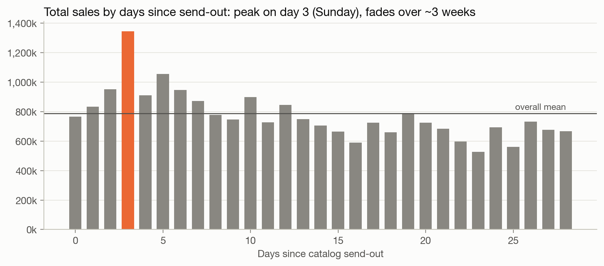

**Natural experiment.** No catalog went out for 42 days (24 Aug → 5 Oct 2023). September 2023 averaged
**€473k/day**, against **€980k/day** in September 2024, when a catalog went out on 12 Sep.

### 5.2 Halo: the catalog lifts sales credited to other channels

In the 7 days after a send-out, total demand rises **+38.4 %** (notebook 01). Sales credited to other channels
rise too:

| Channel | Uplift in the 7 days after send-out |
| --- | ---: |
| SEO | +20 % |
| Social Media | +20 % |
| Direct Type-in | +17 % |
| Affiliate | +14 % |
| SEA | +11 % |

Notebook 01b, with a weekday-adjusted baseline, finds +46 % for total demand. Either way, last-click attribution
gives the catalog only part of the demand it creates. **Modelling total sales with an MMM captures the halo**;
channel attribution cannot.

### 5.3 Correlations: same-day cost vs total sales

| | Affiliate | SEA | Display | PSM | Display Network | Social Media | Catalog |
| --- | ---: | ---: | ---: | ---: | ---: | ---: | ---: |
| Pearson | 0.76 | 0.72 | 0.56 | 0.49 | 0.44 | 0.33 | −0.01 |
| Spearman | 0.68 | 0.70 | 0.50 | 0.49 | 0.44 | 0.37 | 0.00 |

Lagged correlations (cost today vs sales in *k* days) show the catalog's spike at *k* = 3 (0.40); every digital
channel is highest at *k* = 0 and decays from there.

### 5.4 Some costs follow demand (reverse causality)

| Channel | CPC (€) | CPM (€) | r(cost, clicks) | r(cost, own sales) | Attributed ROAS |
| --- | ---: | ---: | ---: | ---: | ---: |
| SEA | 0.37 | 6.01 | **0.96** | 0.82 | 3.93 |
| Catalog | – | 742.20 | – | −0.07 | 2.07 |
| Display | 0.25 | 0.92 | 0.59 | 0.48 | 2.17 |
| Affiliate | 0.51 | 679.42 | 0.50 | **0.80** | 8.21 |
| Display Network | 0.19 | 1.39 | 0.76 | 0.54 | 3.57 |
| Social Media | 0.44 | 2.67 | 0.64 | 0.57 | 1.30 |
| PSM | 0.23 | – | 0.92 | 0.74 | 3.25 |

- **Affiliate** cost is a commission on its own sales: about 7–12 % in 2023, a step to about 15–16 % in
  February 2024. Its high correlation with sales (0.76, the highest) is largely **reverse causality**.
- **SEA** is billed per click (r = 0.96 with clicks), so its daily cost rises whenever search demand rises.
- These two channels keep their correlation with sales after removing trend and calendar, which is a sign of
  demand-following cost, not proof of effectiveness.

### 5.5 Budgets follow the season

- Trend and calendar alone explain **33–52 %** of each digital channel's spend variance.
- Digital spends correlate with each other at r = 0.22–0.58, and monthly digital spend correlates with monthly
  sales at **r = 0.92**.
- Much of the raw correlation disappears once seasonality is removed (Display 0.56 → 0.39, Social 0.33 → 0.15).
- Variance inflation factors are only **1.41–2.41**, so multicollinearity is moderate. The bigger issue is that
  digital channels are always on and move with the season, so their individual effects are **weakly identified**.

### 5.6 Structural breaks

| Channel | Date | What changed |
| --- | --- | --- |
| Social Media | 1 Aug 2024 | Clicks ×8 overnight (≈ 10k → 86k/day) while spend tripled; CTR ~0.25 % → ~1.6 %; attributed sales ×10 within weeks. Likely a campaign-type or tracking change |
| Affiliate | Feb 2024 | Commission rate roughly doubled (~7–12 % → ~15–16 %) |

The Q4 2024 hold-out lies entirely inside both new regimes.

### 5.7 Naive baselines fail the target

| Baseline (full period) | MAE / mean |
| --- | ---: |
| Constant mean | 26.1 % |
| Weekday mean | 24.9 % |
| Last week's value (lag 7) | 26.0 % |
| Yesterday's value (lag 1) | 19.1 % |

None meets 15 %, so the target needs a real model.

### 5.8 External drivers: Google holidays and weather

These analyses were added after the main model (`src/tchibo_mmm/holiday_features.py`, `weather_features.py`,
`feature_selection.py`).

**Google Calendar holidays.** The public "Holidays in Germany" calendar (Calendar API `events.list`, or its iCal
export without an API key) gives public holidays, regional holidays weighted by state population, observances,
eves, bridge days and Advent. After controlling for weekday, season, trend and catalog timing:

- **Holidays lower demand:** half-day holidays (24 and 31 Dec) **−64 %**, the day before a holiday −31 %,
  nationwide public holidays −23 %. The deepest single days are Christmas Eve (−76 %), Christmas Day (−62 %),
  Boxing Day (−55 %) and New Year's Eve (−52 %).
- **Observances and Advent show no reliable effect** once season and catalog timing are controlled.
- **Only `half_day` improved the hold-out,** so it joined the model's calendar controls: Meridian Q4 MAE / mean
  8.53 % → **8.49 %**.

**Weather (Open-Meteo).** A national daily index from the 16 state capitals, weighted by population (ERA5 archive,
forecast API for the next 16 days):

- Raw correlations with sales reach |r| = 0.33, but most of that is the season. After calendar, season and catalog
  controls the largest is |r| = 0.17.
- **Rain goes with higher sales** (precipitation hours +0.17, precipitation mm +0.16); **warm, sunny days go with
  lower sales** (max temperature −0.17, temperature anomaly −0.13, sunshine −0.13). Snow, frost and summer-day
  shares are not significant.
- Weather is known only about 16 days ahead, so `feature_selection.py` scores it at plan time with each feature at
  its seasonal normal. The final model does not include weather controls.

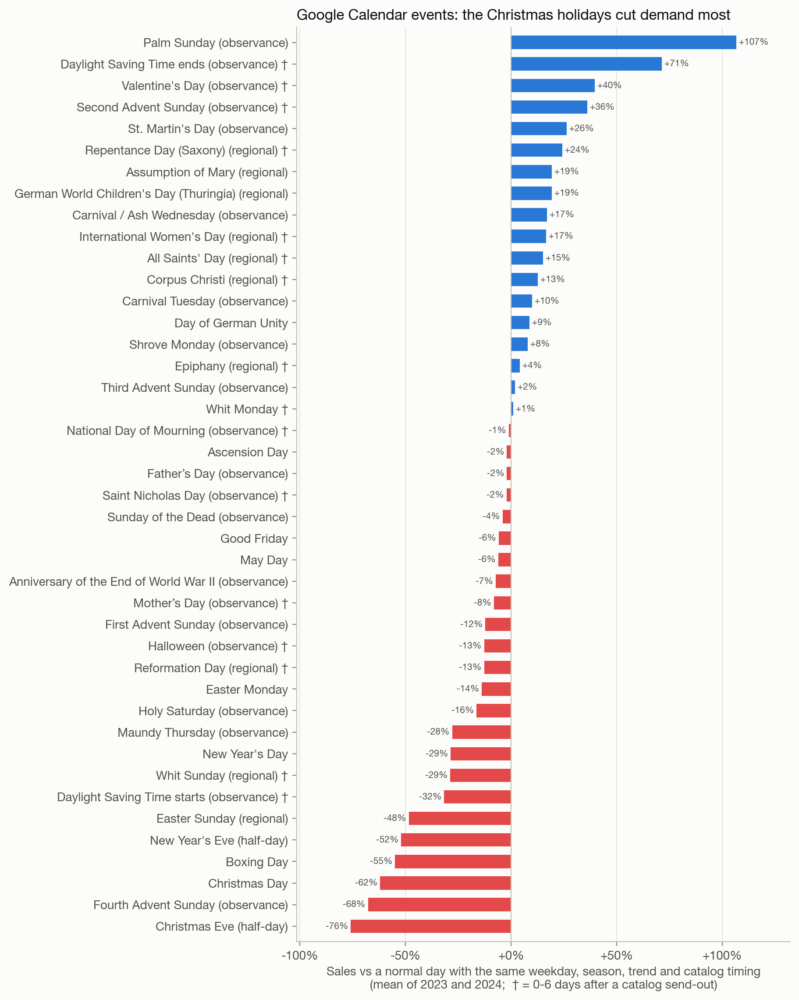

### 5.9 Answers to the brief, section 1

**Q1. What can we conclude from the channel interactions?**

1. Timing matters more than the size of a correlation: the largest budget (catalog) has zero same-day correlation
   but drives the biggest peaks.
2. Channels interact (halo), so attributed sales are not independent effects. Attributed ROAS understates
   upper-funnel media (Catalog, Display) and flatters lower-funnel channels (Affiliate, SEA).
3. Digital budgets move together and with the season, so their individual effects are hard to separate.
4. Some costs are consequences of demand (Affiliate commission, SEA clicks).
5. Strong calendar structure: trend, Q4 peak, weekday cycle, Christmas troughs, Black Friday.

**Q2. What obstacles exist for further processing?**

- Long, shuffled format; NaN means different things (not applicable vs zero spend vs missing).
- Gaps (TV, Catalog, Owned) and one isolated 2025 day.
- Lumpy catalog costs booked on the send-out day, with the effect days later.
- Very different scales (€2.7k/day PSM vs €1.7M catalog days).
- Multicollinearity and reverse causality; media inflation (CPC/CPM drift); structural breaks.
- Short history: two Q4s, two Black Fridays, 28 catalog events.
- Missing drivers: promotions, prices, Tchibo's weekly product "worlds", competitors, TV spend.

**Q3. Which influencing factors cannot be used?**

- **`sales_by_channel`**: it sums to the target, so it is direct target leakage.
- **Same-day clicks and impressions**: outcomes recorded with the sales, not known when forecasting.
- **TV, SEO, Direct Type-in, Direct Referred, Owned**: no costs, so they cannot be budget levers. Their sales stay
  in the target.
- **Realised Affiliate cost (with caution)**: a commission on sales, so it carries demand information.

---

## 6. Data preparation and feature engineering

### 6.1 The wide daily table

Exactly the format the brief asks for: one row per day, **all 12 channels as cost columns**, and `total_sales`
(the sum over all 12 channels) as the dependent variable. Shape: **732 × 13**. The five organic channels' cost
columns are zero on every day; they stay in the table to show this and are dropped from the model inputs.

| Cost column | Mean (€/day) | Median | 95th pct | Max | Zero days |
| --- | ---: | ---: | ---: | ---: | ---: |
| `cost_sea` | 52,608 | 49,302 | 87,662 | 134,199 | 0 |
| `cost_catalog` | 52,674 | 0 | 0 | 1,702,133 | 704 |
| `cost_display` | 40,717 | 37,819 | 72,464 | 112,223 | 0 |
| `cost_affiliate` | 6,604 | 5,351 | 13,520 | 62,275 | 0 |
| `cost_display_network` | 5,591 | 5,080 | 10,598 | 18,134 | 0 |
| `cost_social_media` | 12,054 | 7,760 | 35,572 | 160,307 | 0 |
| `cost_psm` | 2,730 | 2,588 | 4,503 | 7,268 | 0 |

Code: `tchibo_mmm.data.build_wide_table` (notebooks) and `mmm_studio.core.tables` (app).

### 6.2 What to take into account about the costs

| Topic | Observation | How it is handled |
| --- | --- | --- |
| **Booking date** | Cost is booked on the day of causation (the whole catalog cost on its send-out day) | Catalog in-home shift (k = 2) and adstock with `max_lag = 21` |
| **Carry-over** | Effects last days to weeks; about 3 weeks for the catalog | Meridian adstock: geometric, binomial for the catalog |
| **Saturation** | Mostly near-linear in the observed range; Display Network flattens; Social Media is S-shaped | Meridian's Hill curve per channel |
| **Scale** | €2.7k/day (PSM) to €1.0–1.7M per catalog send-out | Meridian scales each channel internally |
| **Zero vs missing** | No cost row = 0 spend (catalog) or not applicable (organic) | Organic excluded; catalog off-days = 0 |
| **Billing model** | SEA per click, Affiliate per sale | SEA's ROI read as upper bound; Affiliate becomes a control |
| **Price drift** | CPC and CPM change over time | Limitation; impressions tested only as a sensitivity |
| **Forecast-time availability** | Future spend must be known in advance | Spend (not impressions) is the media input |

### 6.3 Feature 1: catalog in-home shift

Meridian's two decay curves (geometric `α^lag`, binomial `(1 − lag/(L+1))^(1/α − 1)`) **both peak at lag 0**
(checked in `meridian/model/adstock_hill.py`). The catalog's response peaks 2–3 days after send-out. The fix: move
catalog spend to its **in-home date**, *k* days after send-out, so adstock models the decay from there.

Choosing *k*: regress sales on calendar, seasonality, trend and digital costs, then correlate the residual with the
adstocked, shifted catalog spend:

| Shift *k* (days) | 0 | **1** | **2** | 3 | 4 | 5 |
| --- | ---: | ---: | ---: | ---: | ---: | ---: |
| Binomial decay | 0.54 | **0.59** | **0.59** | 0.48 | 0.30 | 0.21 |
| Geometric decay | 0.52 | 0.58 | 0.58 | 0.49 | 0.33 | 0.28 |

*k* = 1–2 with slow decay (α ≈ 0.8) fits best; *k* = 3 misses the ramp-up. **Default: k = 2.** Notebook 03
confirms it on the Meridian hold-out (§7.3).

### 6.4 Feature 2: calendar controls

| Column(s) | Definition |
| --- | --- |
| `dow_tue` … `dow_sun` | Weekday dummies (Monday is the reference) |
| `holiday` | German public holidays (`holidays` package) |
| `christmas` | 20–31 December |
| `half_day` | 24 and 31 December (Google's half-day holidays; the deepest dips) |
| `black_week` | Black Friday (the day after the 4th Thursday of November) to Cyber Monday |

### 6.5 Feature 3: seasonality and trend

| Column(s) | Definition |
| --- | --- |
| `sin_1, cos_1, sin_2, cos_2` | Yearly Fourier terms, k = 1, 2 (`t = day of year / 365.25`) |
| `trend` | Years since the first day |

These are controls rather than Meridian time knots: knots inside a time-based hold-out see no training data, while
Fourier terms and a trend extend into the future.

### 6.6 How much each feature group adds

In-sample adjusted R² of a plain OLS (out-of-sample validation follows in §7 and §8):

| Step | Adjusted R² |
| --- | ---: |
| Raw costs (7 channels) | 0.74 |
| + calendar controls | 0.76 |
| + seasonality and trend | 0.83 |
| Catalog raw → in-home adstock | **0.90** |

**Catalog timing is the single biggest improvement.**

### 6.7 Which channels matter most (first answer, OLS with Newey-West errors)

OLS of total sales on adstocked costs and all controls (R² 0.906), standardised effects (sales change per 1 SD of
spend) with HAC standard errors:

| Channel | Std. effect (€) | 95 % CI | p-value | Contribution share |
| --- | ---: | --- | ---: | ---: |
| Affiliate | 148,949 | 132,096 – 165,801 | < 0.001 | 25.3 % |
| SEA | 89,350 | 64,335 – 114,365 | < 0.001 | 31.7 % |
| Catalog | 81,786 | 71,111 – 92,462 | < 0.001 | 7.3 % |
| PSM | 9,465 | −6,802 – 25,733 | 0.254 | 3.5 % |
| Display | 865 | −12,639 – 14,370 | 0.900 | 0.3 % |
| Display Network | −644 | −12,695 – 11,408 | 0.917 | −0.2 % |
| Social Media | −4,854 | −16,275 – 6,567 | 0.405 | −0.5 % |

Only Affiliate, SEA and Catalog are significant. Affiliate is inflated by reverse causality; Catalog is likely
understated because its regular schedule overlaps the seasonality controls. Meridian (§9) gives the final answer.

### 6.8 Why channel costs are hard to use as influencing factors

1. **Reverse causality** (the main challenge): budgets are planned around expected demand, and SEA / Affiliate costs
   scale with realised demand. Naive ROIs for these channels are inflated.
2. **Correlated inputs:** digital costs rise and fall together (VIF ≤ 2.4); individual effects get wide intervals.
3. **Timing and shape:** delayed effects (catalog), carry-over and saturation. A same-day linear model reads the
   catalog as r ≈ 0.
4. **Little independent variation:** spend is never switched off experimentally; September 2023 is the only natural
   experiment.
5. **Attribution vs incrementality:** last-click sales are not causal (the halo shows it).
6. **Forecast-time availability:** future costs must come from a plan, and for SEA and Affiliate the plan is only a
   cap.

**Practical consequence:** a good *forecast* is not the same as a *causal* ROI. Lift tests or geo experiments
would calibrate the priors.

### 6.9 The Meridian input table

`data/processed/meridian_input.csv`, built by `tchibo_mmm.features.build_meridian_table`:

| Meridian role | Columns |
| --- | --- |
| `time` | Daily date `YYYY-MM-DD` |
| KPI (`kpi_type="revenue"`) | `total_sales` (monetary, so no `revenue_per_kpi`) |
| Media = media spend | `sea_spend`, `catalog_spend` (shifted +2 days), `display_spend`, `display_network_spend`, `social_media_spend`, `psm_spend` |
| Controls | `dow_tue` … `dow_sun`, `holiday`, `christmas`, `half_day`, `black_week`, `sin_1`, `cos_1`, `sin_2`, `cos_2`, `trend`, **`affiliate_spend`** |
| Not used | Clicks, impressions, `sales_by_channel`, organic channels and TV |

**Spend is the media variable** (not impressions): the forecast has to run on a budget plan, impressions are not
known in advance, and PSM has none.

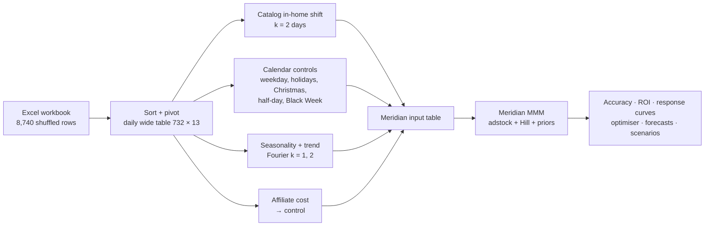

---

## 7. Modelling with Google Meridian

### 7.1 Why Meridian, and why it counts as a regression

Meridian is a Bayesian **linear regression** on transformed media variables:

```text
sales_t = μ                                         intercept (national model, 1 knot)
        + Σ_k γ_k · control_k,t                     weekday, holidays, Christmas, half-day, Black Week,
                                                    Fourier, trend, Affiliate cost
        + Σ_c β_c · Hill_c( Adstock_c(spend_c,t) )  6 paid channels
        + ε_t
```

| Brief question | How Meridian answers it |
| --- | --- |
| What to consider about costs | **Adstock** (carry-over) and **Hill** (saturation), estimated per channel |
| Which channels matter most | Contribution, ROI and marginal ROI per channel, with credible intervals |
| Challenge of costs as inputs | **Priors** regularise correlated channels; wide intervals show honestly what the data cannot identify |
| Forecast from the budget | `Analyzer.expected_outcome(new_data=…)` predicts sales for a planned budget |

It answers both questions in one model: *how much will we sell* (forecast) and *what does each channel return*
(ROI, response curves, optimisation).

### 7.2 Final specification

| Setting | Value | Reason |
| --- | --- | --- |
| Geography | National (single geo) | No geo column in the data |
| Time step | Daily, 732 days | The brief asks for daily demand |
| Media channels | SEA, Catalog, Display, Display Network, Social Media, PSM | The budget levers |
| Affiliate | **Control**, not media | Commission on sales; as media it got an implausible ROI ≈ 50 |
| `max_lag` | 21 days | The catalog effect fades over about 3 weeks |
| Adstock | Binomial for Catalog, geometric for the rest | Flatter, longer catalog tail |
| Saturation | Hill (default) | Diminishing returns |
| Baseline | 1 knot (national default) + trend and Fourier controls | The baseline extends into the hold-out |
| Prior | `media_prior_type="roi"`, `roi_m = LogNormal(0.2, 0.9)` (Meridian default) | Attributed ROAS is not incremental, so it is not used as the prior |
| Hold-out | `HoldoutSpec([DateRange("2024-10-01", "2025-01-01")])` (93 days) | Same window as the OLS benchmark |
| Sampling | 4 chains × 1,000 kept draws (1,000 adapt, 500 burn-in, 500 prior draws), seed 0 | 116 s on a laptop CPU |

Code (`src/tchibo_mmm/mmm.py`):

```python
data = (dfb.DataFrameInputDataBuilder(kpi_type="revenue", default_kpi_column="total_sales")
        .with_kpi(table)
        .with_controls(table, control_cols=controls)        # incl. affiliate_spend
        .with_media(table, media_cols=spend, media_spend_cols=spend, media_channels=channels)
        .build())
model_spec = spec.ModelSpec(max_lag=21, adstock_decay_spec={"catalog": "binomial"},
                            holdout=spec.HoldoutSpec(spec=[spec.DateRange("2024-10-01", "2025-01-01")]))
mmm = model.Meridian(input_data=data, model_spec=model_spec)
mmm.sample_prior(500, seed=0)
mmm.sample_posterior(n_chains=4, n_adapt=1000, n_burnin=500, n_keep=1000, seed=0)
```

### 7.3 Model selection

Fast fits (2 chains × 200 draws), scored on the Q4 2024 hold-out:

| Catalog shift *k* | Affiliate as | Test MAE / mean | Train MAE / mean | Test R² | ROI SEA | ROI Catalog | ROI Affiliate |
| ---: | --- | ---: | ---: | ---: | ---: | ---: | ---: |
| 1 | media | 9.5 % | 8.8 % | 0.85 | 6.82 | 1.23 | 50.32 |
| 1 | control | 8.8 % | 8.2 % | 0.88 | 7.74 | 1.20 | – |
| 2 | media | 8.9 % | 8.9 % | 0.87 | 7.23 | 0.97 | 48.79 |
| **2** | **control** | **8.5 %** | **8.3 %** | **0.89** | 8.43 | 0.97 | – |
| 3 | media | 8.9 % | 9.8 % | 0.88 | 7.95 | 0.66 | 50.15 |
| 3 | control | 8.6 % | 9.3 % | 0.89 | 9.32 | 0.66 | – |

**Decision: k = 2 with Affiliate as a control.** Affiliate as a control wins at every *k* and removes the
implausible ROI of ~50 (reverse causality). It still informs the forecast as a real-time demand signal.

### 7.4 Prior sensitivity

| Variant | Test MAE / mean | ROI SEA | ROI Catalog | ROI Display | ROI Display Network | ROI Social | ROI PSM | Media share of sales |
| --- | ---: | ---: | ---: | ---: | ---: | ---: | ---: | ---: |
| Default prior (final) | 8.5 % | 8.43 | 0.97 | 0.69 | 1.27 | 0.71 | 2.53 | 68 % |
| Attributed-ROAS prior, σ = 0.5 | 8.5 % | 8.18 | 0.97 | 1.41 | 3.17 | 0.97 | 4.31 | 73 % |
| SEA as a control | 8.7 % | – | 0.99 | 0.62 | 1.43 | 0.85 | 2.03 | 13 % |

- **Priors do not move the two big budget lines** (SEA, Catalog) or the hold-out error: the data dominates there.
- **The small channels move toward their priors** (Display, Display Network, PSM): the data identifies them weakly.
- **Catalog's ROI stays ≈ 1 even with SEA as a control**, so "SEA absorbs the catalog halo" is not supported.
- **SEA as media takes about 55 % of all sales.** It forecasts better as media (a strong demand signal), but its ROI
  is an upper bound.

### 7.5 Convergence

| Parameter group | n | Max R-hat |
| --- | ---: | ---: |
| `alpha_m`, `beta_m`, `ec_m`, `roi_m` | 6 each | ≤ 1.001 |
| `gamma_c` (controls) | 16 | 1.002 |
| `mu_t` | 732 | 0.999 |
| `sigma` | 1 | 0.999 |

**Max R-hat 1.002** (threshold 1.2); no parameter flagged. The app's audit also found minimum bulk ESS ≥ 2,177 over
4,000 draws. Meridian's health card is in `outputs/meridian_health_card.html`.

### 7.6 Validation design

| Window | Train | Test | Purpose |
| --- | --- | --- | --- |
| **Q4 2024 hold-out** | 2023-01-01 → 2024-09-30 | 2024-10-01 → 2025-01-01 (93 days) | Main accuracy check: budget + calendar only |
| **Q3 2024 forward hold-out** | 2023-01-01 → 2024-06-30 | 2024-07-01 → 2024-09-30 | Robustness: nothing after September used |
| **Leak-free back-test** | History to 2024-09-30 | Q4 2024 actual spend treated as the plan | Tests the forecast pipeline itself (§11) |
| **Walk-forward CV** (OLS only) | Expanding window | 8 folds × 6 weeks from 2024-01-15 | Stability across the year (§8) |

### 7.7 Accuracy

| Set | MAE | MAE / mean | RMSE | R² | MAPE | Bias (€/day) |
| --- | ---: | ---: | ---: | ---: | ---: | ---: |
| Train (2023-01-01 → 2024-09-30) | 62,435 | 8.3 % | 83,569 | 0.887 | 8.6 % | +11 |
| **Hold-out Q4 2024** | **89,308** | **8.5 %** | **114,770** | **0.889** | 9.3 % | +68,782 |
| Forward hold-out Q3 2024 (train to June) | 86,855 | 10.9 % | 119,440 | 0.686 | 10.0 % | −71,856 |

Meridian's own `predictive_accuracy()`: wMAPE 8.3 % (train), 8.5 % (test), 8.4 % (all data, R² 0.902).

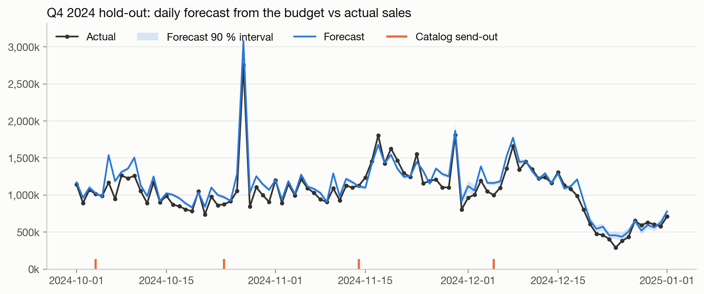

**Reading the scores:**

- **The target is met on both forward hold-outs**, and train and test errors are almost equal, so there is no sign
  of overfitting.
- **Most of the Q4 error is a level offset:** the forecast runs about 6–7 % high on every weekday. The trend and
  Fourier terms extrapolated a slightly higher Q4 level than materialised. Refitting weekly re-anchors the level.
- **Residuals by days since send-out:** the model under-predicts day 1 and over-predicts day 2. The 2-day shift
  plus monotone decay approximates the ramp-up well, but not perfectly. Next step: ramp indicators for days 0–2 as
  `non_media_treatments`.

---

## 8. Benchmark: OLS vs Meridian

Every model is scored on the same hold-outs (notebook 04).

| Model | Inputs |
| --- | --- |
| Naive | Weekday mean of the training period |
| OLS-1 | The 7 raw channel costs only (the literal "sales from budget" regression) |
| OLS-2 | Meridian's inputs: digital costs, catalog in-home adstock, all controls |
| **Meridian** | Bayesian regression with adstock, Hill saturation and priors |

### 8.1 Hold-outs

| Hold-out | Model | MAE | MAE / mean | RMSE | R² |
| --- | --- | ---: | ---: | ---: | ---: |
| Q4 2024 (train to Sep) | Naive weekday mean | 365,930 | 34.8 % | 452,116 | −0.720 |
| | OLS-1 raw costs | 112,415 | 10.7 % | 144,085 | 0.825 |
| | OLS-2 Meridian inputs | 100,775 | 9.6 % | 129,139 | 0.860 |
| | **Meridian MMM** | **89,308** | **8.5 %** | **114,770** | **0.889** |
| Q3 2024 (train to Jun) | Naive weekday mean | 151,504 | 19.0 % | 207,018 | 0.055 |
| | OLS-1 raw costs | 107,575 | 13.5 % | 145,647 | 0.532 |
| | OLS-2 Meridian inputs | 111,492 | 14.0 % | 146,742 | 0.525 |
| | **Meridian MMM** | **86,855** | **10.9 %** | **119,440** | **0.686** |

### 8.2 Walk-forward cross-validation (OLS only; Meridian takes minutes per refit)

| Model | 15 Jan | 26 Feb | 8 Apr | 20 May | 1 Jul | 12 Aug | 23 Sep | 4 Nov | **Mean** | **Worst** |
| --- | ---: | ---: | ---: | ---: | ---: | ---: | ---: | ---: | ---: | ---: |
| Naive weekday mean | 16.9 % | 17.3 % | 14.5 % | 14.9 % | 12.4 % | 22.5 % | 28.4 % | 37.6 % | 20.5 % | 37.6 % |
| OLS-1 raw costs | 11.6 % | 26.9 % | 20.2 % | 16.7 % | 10.6 % | 16.9 % | 6.1 % | 11.2 % | 15.0 % | 26.9 % |
| OLS-2 Meridian inputs | 10.5 % | 9.3 % | 7.4 % | 9.2 % | 8.5 % | 15.5 % | 9.1 % | 6.7 % | **9.5 %** | **15.5 %** |

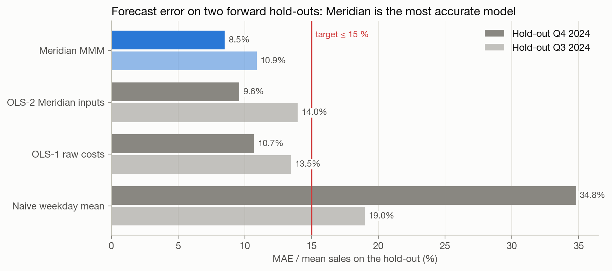

**Takeaways:**

- Naive forecasts fail (19–35 %). Every budget-based regression passes both forward hold-outs.
- **Raw costs alone (OLS-1) are unreliable:** acceptable on the hold-outs, but walk-forward folds swing to 27 %.
  A single hold-out can mislead.
- **OLS-2 with Meridian's inputs is robust** (9.5 % mean, 15.5 % worst fold): the feature engineering does most of
  the work.
- **Meridian is the most accurate on both hold-outs** (8.5 % vs 9.6 % in Q4; 10.9 % vs 14.0 % in Q3), and adds
  what OLS cannot: credible intervals, ROI, response curves and budget optimisation.

---

## 9. Insights: what drives sales

### 9.1 ROI and contribution (final model, posterior mean and 90 % credible interval)

| Channel | Spend (€M) | Share of spend | Incremental sales (€M) | Share of sales | **ROI** | ROI 90 % CI | **Marginal ROI** |
| --- | ---: | ---: | ---: | ---: | ---: | --- | ---: |
| SEA | 38.5 | 31.6 % | 320.5 | 55.0 % | **8.32** | 6.53 – 10.80 | 4.57 |
| PSM | 2.0 | 1.6 % | 4.9 | 0.8 % | **2.46** | 0.32 – 7.96 | 1.23 |
| Display Network | 4.1 | 3.4 % | 5.0 | 0.9 % | **1.23** | 0.24 – 3.32 | 0.52 |
| Catalog | 38.6 | 31.7 % | 37.2 | 6.4 % | **0.97** | 0.87 – 1.07 | 0.78 |
| Social Media | 8.8 | 7.2 % | 6.4 | 1.1 % | **0.72** | 0.19 – 1.65 | 0.28 |
| Display | 29.8 | 24.5 % | 19.6 | 3.4 % | **0.66** | 0.16 – 1.51 | 0.23 |

*ROI = incremental revenue per € of spend. Marginal ROI = revenue from the next € at current spend. The baseline
(calendar, trend, Affiliate control, organic demand) carries the remaining share of sales.*

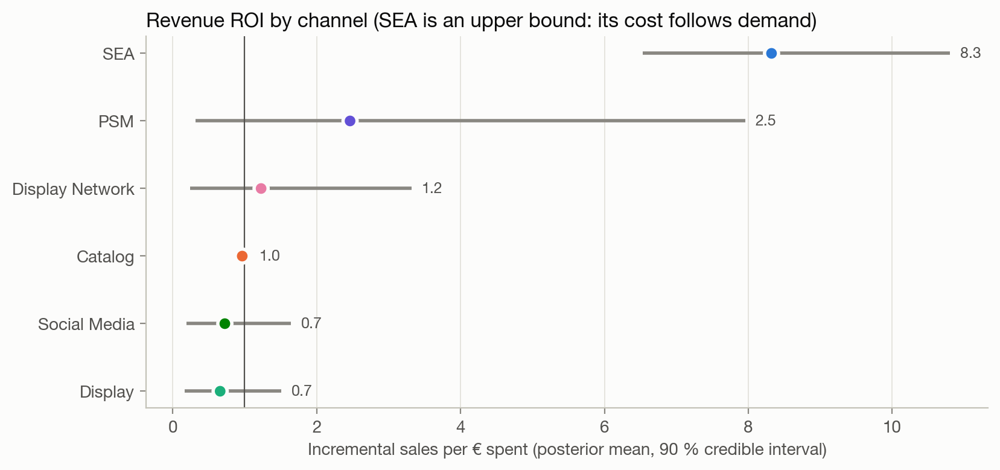

**How to read each channel:**

| Channel | Verdict | Why |
| --- | --- | --- |
| **SEA** | Strong, but an **upper bound** | Cost follows search demand (r = 0.96 with clicks), and its weekly contribution mirrors total demand. Test before scaling |
| **Catalog** | **Pays back about its cost in revenue**; the best-identified channel | Narrow interval (0.87–1.07), pulsed spend, nearly linear response (far from saturation) |
| **PSM** | Probably positive, poorly identified | Interval 0.32–7.96; small budget |
| **Display Network** | Around break-even, poorly identified | Interval 0.24–3.32 |
| **Social Media** | Below break-even on average | Interval 0.19–1.65; regime change in Aug 2024 |
| **Display** | **Saturated** | Marginal ROI 0.23: the next euro returns 23 cents; first candidate for cuts |

*ROI here is revenue ROI. A revenue ROI of 1 covers the media cost but not the cost of goods; whether a channel is
profitable depends on Tchibo's margin.*

### 9.2 Carry-over (adstock)

- **SEA works on the same day**; its effect is gone after 1–2 days, consistent with capturing existing demand.
- **Catalog:** after the in-home date, about half the effect remains after ~3 days, and it fades within ~2 weeks.
- **Display, Display Network, Social Media:** very wide bands; daily data identifies their carry-over weakly.

### 9.3 Saturation (response curves)

- **Catalog is almost linear** at today's spend: every extra send-out returns roughly what it costs.
- **SEA, Display, Display Network and Social Media flatten.** Display is already on the flat part of its curve.

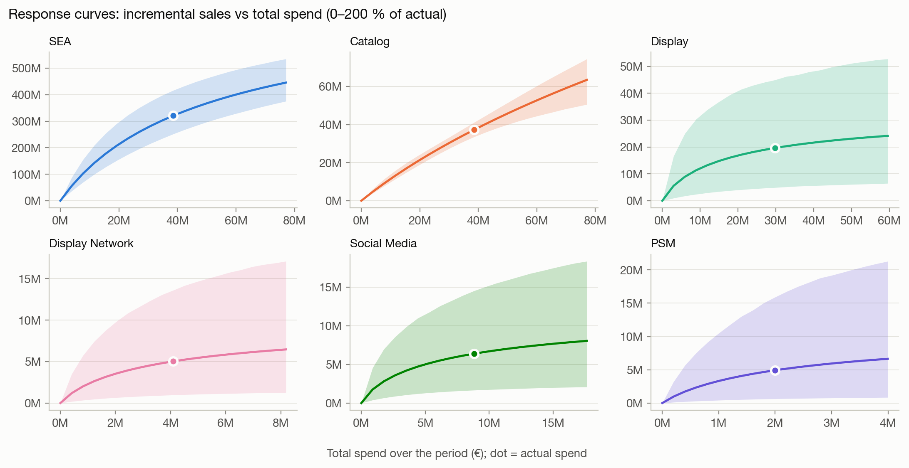

### 9.4 Identification diagnostics (MMM Studio)

The app adds two columns to the ROI table:

- **P(ROI < 1):** the posterior probability that a channel returns less than it costs.
- **Identification flag:** the posterior / prior 90 % interval width on the log scale. A ratio near 1 means the ROI
  is mostly the prior, so the channel needs calibration (a lift test).

Channels whose cost follows demand (daily r(cost, clicks) ≥ 0.9: **SEA and PSM** in this data) are flagged as
**demand-following**; their ROIs are shown as upper bounds.

---

## 10. Budget optimisation and what-if analysis

### 10.1 Same total budget, reallocated (Meridian `BudgetOptimizer`, ±30 % per channel)

| Channel | Current spend (€M) | Optimised spend (€M) | Change (€M) |
| --- | ---: | ---: | ---: |
| SEA | 38.5 | 50.0 | **+11.5** |
| Catalog | 38.6 | 39.2 | +0.6 |
| PSM | 2.0 | 2.6 | +0.6 |
| Display Network | 4.1 | 2.9 | −1.2 |
| Social Media | 8.8 | 6.2 | −2.6 |
| Display | 29.8 | 20.9 | **−8.9** |
| **Total** | **121.8** | **121.8** | 0 |

Incremental sales: €393.7M → €437.7M (**+11.2 %**) at the same budget.

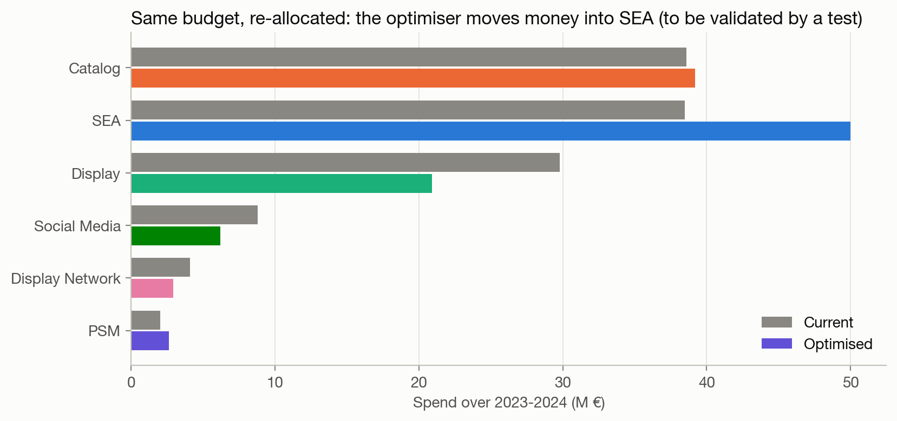

> **Caution.** The optimiser takes the model's ROIs at face value, and its push into SEA inherits SEA's
> upward-biased ROI. The app's audit found that more than 100 % of the lift (107 %) comes from SEA, which means the
> other moves together lose sales. **MMM Studio therefore headlines the optimisation with demand-following channels
> (SEA, PSM) held fixed** and shows the unconstrained lift and its SEA share next to it. A geo or hold-out
> experiment on SEA should come before any budget is moved.

### 10.2 Catalog what-if

*What if the 14 Nov 2024 catalog send-out had been skipped?* The hold-out window works as a planning window:

| Catalog cost saved | Forecast sales lost | Sales lost / cost saved |
| ---: | ---: | ---: |
| €1,501,202 | €1,428,853 | **0.95** |

Skipping a send-out saves about what it would have earned in revenue, consistent with a catalog ROI of about 1.

---

## 11. Forecasting new budget plans

This is the operational use case: marketing supplies a budget plan for the coming weeks, and the model returns a
daily sales forecast with uncertainty.

### 11.1 How it works

Meridian predicts only inside the time window it was fitted on. The plan's days are therefore **appended to the
history as hold-out rows** (their sales are unknown, so they are excluded from the likelihood) and the model is
**refit** (about 2–3 minutes on CPU). The hold-out rows' sales placeholder is the training mean, which leaves
Meridian's KPI scaling unchanged and uses no future sales.

### 11.2 Input: the plan CSV

Template: `data/input/budget_plan_template.csv`.

```csv
date,sea,catalog,display,affiliate,display_network,social_media,psm
2025-01-02,56510.07,0.0,35398.62,8610.64,6189.1,6541.81,4014.84
```

- **Rows:** one per future day, consecutive, starting the day after the last history day.
- **Columns:** planned daily cost in € for every paid channel. Catalog: the full cost on the send-out day.
- The CLI rejects gaps, negative values and missing channel columns; the app also rejects unknown columns.

### 11.3 Run and output

```bash
uv run tchibo-forecast --plan data/input/budget_plan_2025-01.csv --out outputs/forecast_2025-01.csv
```

| Output column | Meaning |
| --- | --- |
| `forecast` | Expected daily sales (posterior mean) |
| `prediction_lo` / `prediction_hi` | 90 % prediction interval: where an *actual* day will land (use for planning) |
| `credible_lo` / `credible_hi` | 90 % credible interval for the *expected* level only (narrower) |
| `planned_spend` | The plan's total spend that day |

### 11.4 Leak-free back-test (does the pipeline forecast well?)

Trained on history up to 2024-09-30 only, with the actual Q4 2024 spend given as the "plan" and no Q4 sales used
anywhere (not even in the KPI scaling):

| MAE / mean | RMSE | R² | Bias | Days inside the 90 % prediction interval |
| ---: | ---: | ---: | ---: | ---: |
| **8.5 %** | 114,840 | 0.889 | +€68,874/day | 82 % |

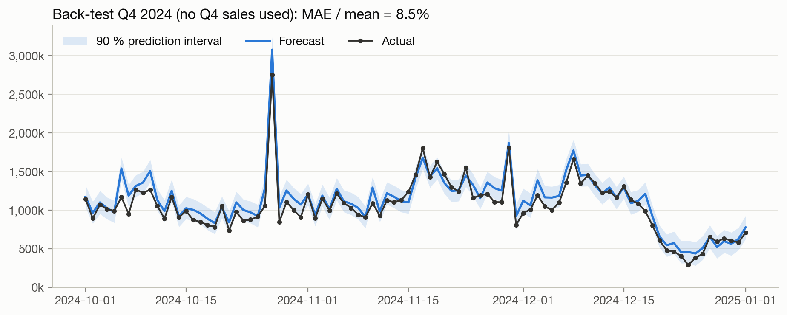

Coverage is below the nominal 90 % because of the level offset (Q4 2024 came in 6–7 % below the trend). Weekly
refits keep this offset small. The app labels the band with its measured back-test coverage.

**Plan-time back-test (MMM Studio).** The back-test above still feeds the *realised* Affiliate commission, which
partly reflects realised demand. The app adds a stricter version in which Affiliate is replaced by a history-only
estimate (the last 56 days' weekday run-rate × last year's seasonal ratio). This is the honest number for a plan
made weeks ahead, and the run's verdict counts it as a window that must also meet the 15 % target.

### 11.5 Example plan: 2 Jan – 12 Feb 2025

Built by `forecast.example_plan` (to be replaced by marketing's real plan): digital channels get the same-weekday
average of the same window in 2024, scaled by each channel's year-on-year spend growth; catalog send-outs on
Thursday 9 Jan and Thursday 30 Jan at the 2024 average cost.

| Week ending | Forecast sales (€) | Low (Σ daily 5 %) | High (Σ daily 95 %) | Planned spend (€) | Days |
| --- | ---: | ---: | ---: | ---: | ---: |
| 2025-01-05 | 4,117,716 | 3,537,239 | 4,709,375 | 512,176 | 4 |
| 2025-01-12 | 7,483,207 | 6,469,250 | 8,492,266 | 2,201,319 | 7 |
| 2025-01-19 | 7,540,236 | 6,521,002 | 8,545,356 | 901,478 | 7 |
| 2025-01-26 | 6,750,886 | 5,732,573 | 7,772,668 | 901,478 | 7 |
| 2025-02-02 | 7,042,299 | 6,015,206 | 8,056,967 | 2,201,319 | 7 |
| 2025-02-09 | 7,043,998 | 6,029,576 | 8,061,885 | 901,478 | 7 |
| 2025-02-16 | 2,613,491 | 2,172,427 | 3,053,261 | 389,301 | 3 |
| **Total** | **42,591,832** | | | **8,008,549** | **42** |

Average €1,014,091 per day. The weekly low/high columns add up daily bounds, so they are deliberately conservative
(wider than a true weekly interval); the app computes interval totals from the posterior draws instead.

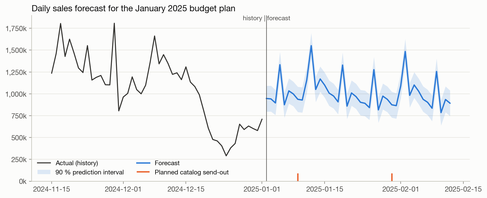

### 11.6 Scenarios on the same window (seconds, no refit)

Alternative plans are evaluated with the **fitted forecast model**. Only media channels change; Affiliate stays as
planned because it is a control.

| Scenario | Sales (€) | Spend (€) | Δ sales | Δ spend | Δ sales / Δ spend |
| --- | ---: | ---: | ---: | ---: | ---: |
| Plan as submitted | 42,591,832 | 8,008,549 | – | – | – |
| Skip the 30 Jan catalog | 41,348,270 | 6,708,708 | −1,243,562 | −1,299,842 | 0.96 |
| Move 20 % of Display to SEA | 43,860,375 | 8,008,549 | +1,268,543 | 0 | – |
| +10 % on all digital channels | 43,761,511 | 8,505,536 | +1,169,679 | +496,987 | 2.35 |

- **Skipping a catalog** saves its cost but loses about the same in sales (ROI ≈ 1).
- **Display → SEA** gains sales at zero cost, driven by SEA's upward-biased ROI: test it before acting.
- **+10 % digital** returns €2.35 per extra €, mostly through SEA.

### 11.7 Operating the forecast

1. Marketing fills the plan template with planned daily costs.
2. Run `tchibo-forecast` (CLI) or upload the plan on the app's **Forecast & scenarios** page.
3. When new actual sales arrive, append them to the workbook so the next forecast refits on the latest level
   (weekly refits recommended).

---

## 12. MMM Studio: the web application

### 12.1 Purpose

**MMM Studio** (`src/app/`) is a standalone full-stack application: **upload only the Excel workbook** and it
re-implements, in its own code, everything notebooks 01–05 do (data audit, EDA, correlations, catalog deep dive,
data preparation, Meridian MMM, OLS benchmark, optimiser, forecasts and scenarios), and presents every chart,
table and insight interactively. It is labelled an independent case-study prototype and uses Tchibo's design tokens
(no logo).

### 12.2 Design principles

| Principle | What it means |
| --- | --- |
| **Self-contained** | Never imports `tchibo_mmm`; never reads `notebooks/`, `outputs/`, `data/processed/` or `reports/` at runtime. Own `pyproject.toml` and `uv.lock` |
| **Results are data** | Each pipeline stage writes a `Section` JSON made of blocks (`markdown`, `kpis`, `chart` (Plotly figure dict), `table`, `callout`). One generic React `SectionRenderer` shows them all |
| **Framework-free core** | `core/` (analytics) and `pipeline/` (stages → sections) import neither FastAPI nor the queue; the CLI, workers and tests call them directly |
| **The API never imports Meridian** | Everything that touches a fitted model runs on a worker; the API image stays slim (no TensorFlow) |
| **Fail loudly** | A short history, an infeasible budget, an unknown plan column or a failed solver is an error with a plain-words reason, never a silent fallback |
| **No invented numbers** | Every KPI, caption and verdict is computed from the data or the model; pending results say so |
| **Data roles are confirmed, not guessed silently** | Channel roles, demand-following channels, hold-out window and regime breaks are inferred from the workbook, shown to the user, and frozen into the run |

### 12.3 Architecture

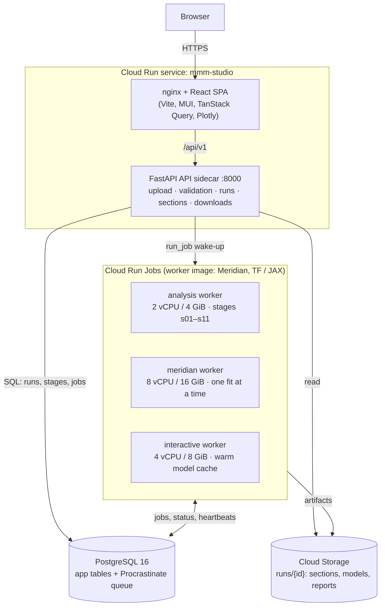

| Layer | Technology |
| --- | --- |
| API | FastAPI, uvicorn, pydantic 2, pydantic-settings, Python 3.12 |
| Database | SQLAlchemy 2.0 + PostgreSQL 16 (psycopg 3), Alembic migrations |
| Task queue | **Procrastinate** 3.10 (Postgres-backed): queues, locks, abort, burst workers. No extra broker |
| Analytics | Google Meridian 2.1.0 (TensorFlow 2.21, JAX), statsmodels, scipy, pandas |
| Frontend | React 18.3, TypeScript 5.5, Vite 7, MUI 5, TanStack Query 5, react-router 7, `react-plotly.js` |
| Storage | Local folder in development, Google Cloud Storage in the cloud |
| Deployment | Cloud Run service + 3 Cloud Run Jobs, Cloud SQL, Artifact Registry, Secret Manager, Cloud Build |

### 12.4 The pipeline (16 stages)

| Stage | Queue | What it produces | Notebook |
| --- | --- | --- | --- |
| `s01_ingest` | analysis | Validate and ingest the workbook (critical) | 01 |
| `s02_quality` | analysis | Data quality and coverage audit | 01b §3 |
| `s03_target` | analysis | Target deep dive: STL, ACF, events | 01b §5 |
| `s04_channels` | analysis | Channel sales mix and seasonality | 01b §6 |
| `s05_spend` | analysis | Media spend and flighting | 01b §7 |
| `s06_efficiency` | analysis | Funnel efficiency and regime breaks | 01b §8 |
| `s07_correlations` | analysis | Correlations, lags, VIF | 01, 01b §9 |
| `s08_catalog` | analysis | Catalog event study and halo | 01, 01b §10 |
| `s09_readiness` | analysis | MMM readiness and naive baselines | 01b §11 |
| `s10_preparation` | analysis | Data preparation and features | 02 |
| `s11_benchmark` | analysis | OLS benchmark and walk-forward CV; draft overview and brief | 04 |
| `s12_meridian_fit` | meridian | Final fit, Q4 hold-out and Q3 forward hold-out (critical) | 03 |
| `s13_drivers_and_optimiser` | meridian | ROI (+ P(ROI < 1), identification), response curves, optimiser, HTML reports | 03 |
| `s14_forecast` | meridian | Back-test, plan-time back-test, example-plan forecast, scenarios | 05 |
| `s15_finalize` | meridian | Final overview, brief and reports | – |
| `s16_model_selection` | meridian | Selection grid and prior sensitivity (full profile only) | 03 §1 |

The analysis job defers the Meridian job when it finishes, so Meridian never runs before or alongside it. A failed
non-critical stage is recorded and the run continues. Every Meridian fit runs in a spawned child process with
cancellation and a timeout.

**Sampling profiles:**

| Profile | Main fit | Selection / forward fits | Typical runtime (laptop CPU) |
| --- | --- | --- | --- |
| `full` | 4 chains × 1,000 draws (notebook-equal) | 2 × 200 | 15–25 min (incl. selection grid) |
| `quick` | 2 × 200 | 2 × 200 | ~6 min |
| `smoke` | 2 × 50 | 2 × 50 | ~4 min (tests) |
| `custom` | User-defined (bounded) | ≤ 2 × 200 | – |

### 12.5 Background jobs

| Task | Queue | Trigger | Notes |
| --- | --- | --- | --- |
| `run_analysis_job` | analysis | `POST /runs/{id}/start` | Stages s01–s11, lock `analysis:{id}` |
| `run_meridian_job` | meridian | End of the analysis job | Stages s12–s16, lock `meridian_singleton` (one fit at a time) |
| `run_forecast_job` | meridian | A new budget plan | Meridian refit on history + plan window |
| `run_scenario_job` | interactive | A planner lever change | ~1.3 s when warm (cached plan draws) |
| `run_optimiser_job` | interactive | The optimiser form | Response-curve optimiser (SLSQP, € millions, PCHIP gradients) |

Reliability rules: Postgres is the system of record; running jobs write heartbeats and a stale-run sweep fails runs
whose worker was lost; jobs left in `doing` by a killed worker are released; cancel is an abort request checked
between stages; a capacity limit on queued Meridian fits returns 429.

### 12.6 Pages

| Group | Page | Route | Content |
| --- | --- | --- | --- |
| – | Executive overview | `/overview` | Verdict vs the 15 % target, headline KPIs, key findings |
| Run | Runs | `/runs` | Upload a workbook, list runs, make default, delete |
| | Run setup | `/setup` | Settings in tabs: Data · Channels · Model · Priors · Sampling, with change counts and "Reset to notebook defaults" |
| | Run status | `/status` | Lifecycle stepper, pipeline lanes per queue, live stage durations, cancel |
| Data & EDA | Data quality | `/data-quality` | Coverage, missing days, value ranges |
| | Exploratory analysis | `/explore` | 7 tabs: target, channels, spend, efficiency, correlations, catalog, readiness |
| | Data preparation | `/preparation` | Wide table, cost handling, shift scan, features, OLS importance |
| Modelling | Meridian model | `/model` | Selection, fit, convergence, accuracy, residuals, settings used |
| | Drivers & ROI | `/drivers` | ROI, contribution, adstock, response curves, P(ROI < 1), identification |
| | Benchmark vs OLS | `/benchmark` | Hold-outs and walk-forward CV |
| Decisions | Budget optimiser | `/optimizer` | Same-budget optimisation plus your own limits: per-channel bounds, a different total budget, catalog fixed or free |
| | Forecast & scenarios | `/forecast` | Planner: budget levers, history + forecast chart, scenarios with 90 % intervals, per-channel effects |
| Deliverables | Reports & downloads | `/reports` | Meridian HTML reports (summary, optimisation, health card), CSV / Parquet exports |
| | Answers to the brief | `/brief` | Every brief question answered from the run's own numbers |

### 12.7 API reference (`/api/v1`)

| Method | Path | Purpose |
| --- | --- | --- |
| GET | `/health` | Health and whether auth is required (public) |
| GET | `/auth/session` | Current session and whether auth is required (public) |
| POST | `/auth/login`, `/auth/check`, `/auth/logout` | Sign in with the access code, check it, sign out (public) |
| POST | `/runs` | Upload a workbook → profiled `draft` run with inferred roles |
| GET | `/runs`, `/runs/{id}` | List runs / run detail with stages and summary |
| PATCH | `/runs/{id}` | Rename any time; change roles and settings only for drafts (409 otherwise) |
| GET | `/runs/settings/defaults` | Default settings and limits for the form |
| POST | `/runs/{id}/start` | Validate settings and start (or re-run) |
| POST | `/runs/{id}/cancel`, `/runs/{id}/activate` | Cancel / mark as the default run |
| DELETE | `/runs/{id}` | Delete a run and its artifacts |
| GET | `/runs/{id}/sections`, `/runs/{id}/sections/{key}` | Section index / one section's JSON |
| GET | `/runs/{id}/plan-template`, `/runs/{id}/history` | Plan CSV template / daily history for the planner |
| GET, POST | `/runs/{id}/forecasts` | List / submit a budget plan (202, queued) |
| GET | `/forecasts/{id}` | Forecast result |
| POST | `/forecasts/{id}/scenarios`; GET `/scenarios/{id}` | Scenario on a fitted forecast model |
| GET, POST | `/runs/{id}/optimisations`; GET `/optimisations/{id}` | Constrained budget optimisation |
| GET | `/runs/{id}/artifacts`, `/runs/{id}/artifacts/{path}` | Downloads and HTML reports |

When an access code is set, every route except `/health` and `/auth/*` needs the HttpOnly session cookie or the
`X-Access-Code` header. Failed sign-ins are rate-limited per client and globally.

### 12.8 Run settings

Every default is the notebooks' value, so a run on the defaults reproduces notebooks 01–05.

| Area | Settings |
| --- | --- |
| Data | Hold-out length (default 93 days, ≥ 365 training days required), drop trailing isolated days, missing-row controls (on by default; off for exact notebook parity) |
| Channels | Role per channel (`paid`, `digital_paid`, `print_event`, `commission`, `control`, `unpaid`, `ignored`), adstock shape (geometric / binomial), saturation (Hill / none), in-home shift, demand-following flag |
| Model | Calendar groups, Fourier pairs (0–6), trend, `max_lag` (1–60), baseline (constant / knots / automatic knots), Hill before adstock |
| Priors | Media prior type (ROI, mROI, contribution, coefficient); ROI prior: Meridian default, attributed ROAS (training days only), or custom per channel (median, σ) for lift-test calibration |
| Sampling | Profile (full / quick / smoke / custom), forward hold-out, selection grid and its catalog shifts |

Settings are frozen once a run starts; the Runs table and the Meridian page list every setting that differs from
the defaults.

### 12.9 Storage layout (per run)

| Path under `runs/{run_id}/` | Contents |
| --- | --- |
| `input/workbook.xlsx` | The upload |
| `data/` | `wide_model.parquet` (modelling panel) and other tables |
| `meta/` | `profile.json`, `config.json`, `summary.json`, `meridian_metrics.json` |
| `sections/` | One JSON per section + `_index.json` |
| `models/` | `meridian_final.binpb`, `meridian_forecast.binpb` |
| `reports/` | Meridian HTML reports (post-processed: brand font, € labels, channel colours) |
| `forecasts/{fid}/`, `scenarios/{sid}/`, `optimisations/{oid}/` | Per-request results |

### 12.10 Parity with the notebooks

A full-profile CLI run (seed 0, default settings) against the re-run notebooks:

| Metric | App | Notebook |
| --- | ---: | ---: |
| Q4 hold-out MAE / mean | 8.54 % | 8.49 % |
| Q4 hold-out R² | 0.888 | 0.889 |
| Q3 forward MAE / mean | 11.05 % | 10.88 % |
| ROI SEA / Catalog | 8.53 / 0.96 | 8.32 / 0.97 |
| Optimiser lift on €121.8M | +11.0 % | +11.2 % |
| Catalog what-if ratio | 0.95 | 0.95 |
| Example-plan forecast | €42.61M | €42.59M |

The differences are MCMC noise. A broader check (before `half_day`) matched 1,614 of 1,620 numbers printed by
notebooks 01–05.

---

## 13. Quality assurance and validation

| Layer | What is checked | Where |
| --- | --- | --- |
| Golden numbers | EDA facts, naive baselines, OLS ladder 0.74 → 0.90, OLS benchmark 34.8 / 10.7 / 9.6 %, walk-forward 9.5 %, example plan €8,008,549 | `src/app/backend/tests/golden/case_study.json` |
| Unit tests | Workbook profiling, tables, EDA, preparation, OLS, settings | `tests/core/` |
| Pipeline test | Stages s01–s11 on the fixture; every section renders | `tests/test_pipeline_fast.py` |
| API and jobs | Upload → start → sections, cancel, auth, 429, locks, stale heartbeats, no double run | `tests/test_api.py`, `tests/test_jobs.py` (Postgres) |
| Meridian smoke | Real MCMC fit with smoke sampling, end to end | `tests/test_meridian_smoke.py` (`@slow`, nightly CI) |
| Audit regressions | One test per audit finding (43 findings, all fixed) | `tests/core/test_audit_remediations.py` |
| Frontend | Type check, Vite build, vitest unit tests | `npm test`, CI |
| CI | Ruff + fast tests on push / PR; slow Meridian tests nightly | `.github/workflows/app-ci.yml` |

**Independent statistical audit** (`src/app/audit/STATISTICAL_VALIDATION.md`), verified against Meridian's
`Analyzer` on the stored 4 × 1,000-draw posterior:

- The daily decomposition adds up to floating-point precision (max error €7 × 10⁻⁹).
- ROI means and intervals match the posterior draw ratios to 4 decimals.
- Response curves are monotone; marginal ROI matches the curve slope within 0.5 %.
- Convergence: R-hat ≤ 1.004, bulk ESS ≥ 2,177. Same seed → identical results.

The audit also found presentation issues (unconditional verdicts, an optimiser headline driven by SEA, interval
coverage below nominal, realised commission in the hold-out). All were fixed; see
`src/app/audit/REMEDIATION_STATUS.md`.

---

## 14. Limitations and risks

| Limitation | Impact | Mitigation |
| --- | --- | --- |
| **Reverse causality (SEA, Affiliate)** | SEA's ROI (8.3) and the optimiser's SEA push are upper bounds; realised Affiliate cost carries demand information. Refitting without Affiliate raised the Q4 error from 8.6 % to 11.3 % in the audit | Affiliate as a control; plan-time back-test with a history-only Affiliate estimate; demand-following channels held fixed in the optimiser headline; **experiments** |
| **Weakly identified small channels** | Display Network, PSM, Social ROIs move with the prior | Read with intervals; identification flag; lift tests → custom priors |
| **Level offset in Q4 2024** | Forecast ~6–7 % high; 90 % band covered 80–82 % of days | Weekly refits; band labelled with its measured coverage |
| **Short history** | Only two Q4s, two Black Fridays, 28 catalog events | More history; refit as data arrives |
| **Structural breaks** | Social Media (Aug 2024) and Affiliate (Feb 2024) regimes; hold-out entirely in the new regime | App detects regime breaks from the data; confirm causes with marketing |
| **Catalog ramp-up approximation** | Under-predicts day 1, over-predicts day 2 after send-out | Ramp indicators for days 0–2 as `non_media_treatments` |
| **Missing drivers** | Promotions, prices, weekly product "worlds", competitors, TV spend not in the data | Add as controls when available; holidays done, weather tested |
| **Meridian forecasts only inside its window** | Every new plan needs a refit (2–3 min) | Refit on the plan window; scenarios reuse the fitted model in seconds |
| **Forecast-time spend** | For SEA and Affiliate the plan is only a cap | Plan-time back-test; treat their plan as an estimate |
| **Revenue ROI, not profit** | ROI ≈ 1 covers media cost, not cost of goods | Combine with margin data before budget decisions |

---

## 15. Recommendations and next steps

**For marketing (decisions):**

1. **Use the model for short-term steering now.** It forecasts daily demand from the plan at ~8.5–11 % error.
   Refit weekly so the level stays anchored.
2. **Run an SEA geo or hold-out test** before moving budget into SEA. It is the largest lever in the optimiser and
   the least causally certain.
3. **Review Display spend:** marginal ROI 0.23 says it is saturated at today's level. Test a cut.
4. **Keep the catalog, and decide send-outs on margin:** revenue ROI ≈ 1 with a tight interval, plus a halo on
   other channels. Whether it is profitable depends on the margin of catalog-driven orders.
5. **Calibrate small channels with lift tests** (PSM, Display Network, Social Media) and feed the results back as
   ROI priors (the app's custom prior setting).

**For data science (model improvements):**

- Add catalog ramp-up indicators (days 0–2) as non-media treatments.
- Add promotion, price and product-world calendars as controls; test a Social Media regime control.
- Geo-level data (states or regions) would make channel effects far better identified.
- Automate weekly refits and track the 15 % KPI over time (see §16).

---

## 16. Google Cloud MLOps mapping

> **Full architecture:** [GCP_ML_LIFECYCLE.md](GCP_ML_LIFECYCLE.md) covers the weekly Vertex AI pipeline, the
> promotion gate, serving patterns, monitoring thresholds, retraining triggers, CI/CD, security, a compiled KFP
> pipeline sketch and a roll-out roadmap.

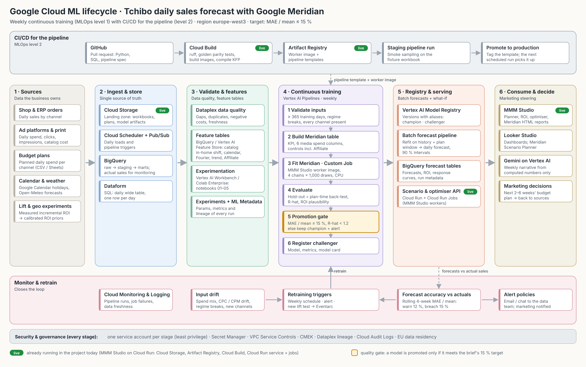

Reference architecture: data → features → training → evaluation → registry → serving → monitoring → retraining,
with three automation levels (0: manual notebooks; 1: continuous-training pipeline; 2: CI/CD for the pipelines).

| Lifecycle step | Google Cloud service |
| --- | --- |
| Data | BigQuery (sales and costs), Cloud Storage, Dataflow / Dataform |
| Features | Vertex AI Feature Store (features in BigQuery) |
| Experimentation | Vertex AI Workbench / Colab Enterprise (Meridian on GPU), Vertex AI Experiments |
| Training pipeline | Vertex AI Pipelines (Kubeflow / TFX), Custom Training running the Meridian fit |
| Model management | Vertex AI Model Registry (saved `.binpb` model), Model Evaluation |
| Serving | Batch Prediction for daily forecasts; Endpoints for what-if scenarios |
| Monitoring | Vertex AI Model Monitoring (drift; wMAPE tracked against 15 %), Cloud Monitoring and Logging |
| Orchestration, CI/CD | Cloud Composer (Airflow), Cloud Scheduler, Cloud Build, Artifact Registry |
| Consumption | Meridian Scenario Planner, Looker / Looker Studio |

Alternatives worth naming: BigQuery ML (`LINEAR_REG`, `ARIMA_PLUS_XREG`, `BOOSTED_TREE`, `AI.FORECAST` with
TimesFM), Vertex AI Forecasting (AutoML), Gemini on Vertex AI for insight narratives, Vertex AI Vizier for tuning.

**What is already deployed:** MMM Studio runs on Cloud Run (`europe-west3`) with Cloud SQL PostgreSQL 16, a GCS
artifact bucket, Artifact Registry, Secret Manager and three scale-to-zero Cloud Run Jobs as workers. Only the
Cloud SQL instance is billed while idle. `src/app/deploy/deploy.sh` provisions and deploys everything idempotently.

---

## 17. Reproducibility: command reference

Requires [uv](https://docs.astral.sh/uv/); Python 3.12 is pinned in `.python-version`.

**Case-study notebooks and forecast CLI** (from the repository root):

```bash
uv sync
```

```bash
uv run jupyter lab
```

```bash
uv run tchibo-forecast --plan data/input/budget_plan_2025-01.csv --out outputs/forecast_2025-01.csv
```

**External features** (cached in `data/external/`; `--refresh` fetches again):

```bash
uv run python -m tchibo_mmm.holiday_features
```

```bash
uv run python -m tchibo_mmm.weather_features
```

```bash
uv run python -m tchibo_mmm.feature_selection --meridian
```

**MMM Studio offline pipeline** (no database; from `src/app/backend`):

```bash
uv run --project ../../.. python -m mmm_studio.cli run --input ../../../data/DataScienceMarketingUseCase.xlsx --out ../../.app_data/runs/cli_demo --profile quick --skip-meridian
```

```bash
uv run --project ../../.. python -m mmm_studio.cli run --input ../../../data/DataScienceMarketingUseCase.xlsx --out ../../.app_data/runs/cli_full --profile full
```

**MMM Studio full stack** (from the repository root):

```bash
docker compose -f src/app/docker-compose.yml up --build
```

Web UI at `http://localhost:8080`, API docs at `http://localhost:8000/docs`. Without Docker, `./src/app/start.sh`
starts the API, one worker per queue and the Vite dev server (see `src/app/README.md`).

**Tests** (from `src/app/backend`; needs PostgreSQL via `TEST_DATABASE_URL`):

```bash
uv run --project ../../.. pytest tests/ -m "not slow" -q
```

```bash
uv run --project ../../.. pytest tests/test_meridian_smoke.py
```

**Deploy to Google Cloud** (after `gcloud auth login`):

```bash
GCP_PROJECT_ID=formare-dev ./src/app/deploy/deploy.sh
```

---

## 18. Glossary

| Term | Meaning |
| --- | --- |
| **MMM** | Marketing mix model: a regression of total sales on marketing spend and controls, used to measure channel effects and plan budgets |
| **Meridian** | Google's open-source Bayesian MMM framework (v2.1.0 here) |
| **Adstock** | Carry-over: spend keeps working on later days, with a decay curve (geometric or binomial) up to `max_lag` days |
| **Hill saturation** | A curve that gives diminishing returns as spend rises |
| **In-home shift** | Moving catalog spend from its send-out day to the day it reaches homes (k = 2 days) |
| **Halo** | A channel lifting sales credited to other channels (the catalog lifts SEO, Direct, Social…) |
| **ROI** | Incremental revenue per € of spend over the whole period |
| **Marginal ROI (mROI)** | Revenue from the next € at current spend; < 1 means the next euro does not pay for itself |
| **Attributed ROAS** | Last-click revenue ÷ spend from the workbook; not incremental |
| **Reverse causality** | Cost that follows demand (per-click or commission billing), which inflates naive ROIs |
| **Demand-following channel** | App flag for channels whose daily cost correlates ≥ 0.9 with their own clicks (SEA, PSM) |
| **MAE / mean (wMAPE)** | Mean absolute error divided by mean actual sales; the brief's KPI (≤ 15 %) |
| **Hold-out** | A time window hidden from training and used to score real forecasts |
| **Credible interval** | Bayesian uncertainty of the expected value |
| **Prediction interval** | Where an actual observation is expected to fall (adds residual noise) |
| **R-hat** | MCMC convergence diagnostic; values near 1 (< 1.2) mean the chains agree |
| **Back-test** | Re-running the forecast pipeline on a past window as if it were the future |
| **Plan-time back-test** | A back-test where demand-dependent costs (Affiliate) are replaced by values known at planning time |
