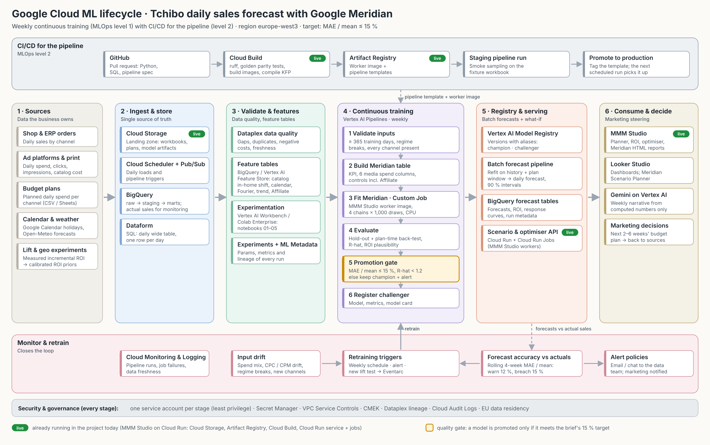

# Google Cloud ML lifecycle: architecture for the Tchibo Meridian MMM (bonus)

> **The brief's bonus question:** describe the ML lifecycle in Google's reference architecture and name the Google
> Cloud ML services that fit this use case.
>
> **The answer in one paragraph:** the weekly MMM runs as a **Vertex AI pipeline** on data in **BigQuery**.
> The pipeline validates the inputs, fits Meridian in the existing MMM Studio worker image, scores the hold-out and a
> plan-time back-test, and promotes the model only when it meets the brief's **MAE / mean ≤ 15 %** target. Accepted
> models go to the **Vertex AI Model Registry**. Forecasts for marketing's budget plans run as batch refits and are
> written back to BigQuery. What-if scenarios and the optimiser are served by the **Cloud Run** app that is already
> deployed (MMM Studio). Accuracy against actual sales, input drift and pipeline health are monitored, and alerts,
> new lift tests or the weekly schedule trigger retraining. **Cloud Build** tests and deploys the pipeline itself.



*Source: [`reports/figures/gcp_ml_lifecycle.svg`](../reports/figures/gcp_ml_lifecycle.svg), drawn by
[`docs/diagrams/gcp_ml_lifecycle.py`](diagrams/gcp_ml_lifecycle.py) (`python docs/diagrams/gcp_ml_lifecycle.py`).
Components marked **live** already run in the project today.*

---

## Contents

1. [Where the project stands: Google's MLOps maturity levels](#1-where-the-project-stands-googles-mlops-maturity-levels)
2. [Design principles for an MMM](#2-design-principles-for-an-mmm)
3. [The lifecycle, stage by stage](#3-the-lifecycle-stage-by-stage)
4. [Evaluation and the promotion gate](#4-evaluation-and-the-promotion-gate)
5. [Serving: three patterns](#5-serving-three-patterns)
6. [Monitoring and retraining](#6-monitoring-and-retraining)
7. [CI/CD for the pipeline (level 2)](#7-cicd-for-the-pipeline-level-2)
8. [Security, governance and responsible use](#8-security-governance-and-responsible-use)
9. [Pipeline sketch (Vertex AI Pipelines, KFP v2)](#9-pipeline-sketch-vertex-ai-pipelines-kfp-v2)
10. [Weekly operating rhythm](#10-weekly-operating-rhythm)
11. [Other Google Cloud ML services, and when to use them](#11-other-google-cloud-ml-services-and-when-to-use-them)
12. [Roll-out roadmap](#12-roll-out-roadmap)

---

## 1. Where the project stands: Google's MLOps maturity levels

Google's MLOps reference architecture describes three levels of automation:
[*MLOps: Continuous delivery and automation pipelines in machine learning*](https://cloud.google.com/architecture/mlops-continuous-delivery-and-automation-pipelines-in-machine-learning).

| Level | Google's definition | This project | Status |
| --- | --- | --- | --- |
| **0: Manual** | Notebooks, manual hand-over of a model, no automation | Notebooks 01–05 and the `tchibo-forecast` CLI | ✅ Done |
| **0+: On-demand service** | (Not a Google level.) Reproducible runs behind an app | **MMM Studio** on Cloud Run: every workbook upload is a versioned run on a job queue; the forecast planner, optimiser and reports are served | ✅ **Live** in `europe-west3` |
| **1: Continuous training (CT)** | An automated pipeline retrains on fresh data, validates data and model, and serves the new model | A scheduled **Vertex AI pipeline** on BigQuery data, with a promotion gate, model registry and monitoring | 📐 This design |
| **2: CI/CD for pipelines** | Pipeline code is tested, built and deployed automatically | **Cloud Build** tests the code and builds images today; it would also compile, stage and promote the pipeline | 📐 This design (partly live) |

**What is already running** (see `src/app/deploy/deploy.sh`): Cloud Run service `mmm-studio` (nginx + React SPA +
FastAPI sidecar), three scale-to-zero **Cloud Run Jobs** as workers (analysis, Meridian, interactive), Cloud SQL
PostgreSQL 16, the GCS bucket `<project>-mmm-studio-artifacts`, Artifact Registry `mmm-studio`, Secret Manager and
Cloud Build. Only Cloud SQL is billed while idle. The target architecture **builds on these** instead of replacing
them.

---

## 2. Design principles for an MMM

An MMM is not a typical online-prediction model, and the architecture follows from that:

| Property of the use case | Consequence for the architecture |
| --- | --- |
| **Meridian predicts only inside the window it was fitted on** | "Serving" a forecast is a **refit** on history + plan window (2–3 min on CPU), so forecasting is a batch pipeline, not an online endpoint |
| **One national, daily model; one fit takes ~2 minutes on CPU** (4 chains × 1,000 draws in 116 s) | CPU custom jobs are enough; GPUs are optional. Costs are minutes of compute per week |
| **Small data** (one row per day, ~25 columns) | BigQuery tables are the feature store; Vertex AI Feature Store is optional |
| **The level drifts** (the Q4 2024 forecast ran 6–7 % high) | **Weekly refits** are the main defence; accuracy is monitored against actuals |
| **ROIs of demand-following channels (SEA) are upper bounds** | The promotion gate checks ROI plausibility; **lift and geo experiments** feed calibrated priors back in |
| **The analytics code already exists twice:** notebooks (frozen) and `mmm_studio.core` (maintained, framework-free, golden-tested) | The pipeline **reuses the MMM Studio worker image and its `mmm-studio run` CLI**; there is no third implementation |
| **Decisions are made by people** (marketing budget plans) | Every output lands in BigQuery and in the apps people already use; Gemini narrates computed numbers only |

---

## 3. The lifecycle, stage by stage

### 3.1 Sources

| Source | Content | Frequency |
| --- | --- | --- |
| Shop and ERP orders | Daily sales attributed per channel (the target is their sum) | Daily |
| Ad platforms and print | Daily spend, clicks, impressions; catalog cost and circulation per send-out | Daily / per send-out |
| Budget plans | Planned daily spend per channel for the next 2–6 weeks (the CSV template, or a Google Sheet) | Weekly / on demand |
| Calendar and weather | Google Calendar "Holidays in Germany"; Open-Meteo forecasts (16 days ahead) | Daily |
| Lift and geo experiments | Measured incremental ROI per channel and test period | Per experiment |

### 3.2 Ingest and store

| Service | Role here |
| --- | --- |
| **Cloud Storage** (live) | Landing zone for workbooks, plan files and model artifacts (`.binpb`, HTML reports) |
| **Cloud Scheduler + Pub/Sub** | Daily loads; publish "new data landed" and "plan submitted" events |
| **BigQuery** | Raw → staging → marts. The single source of truth for actual sales, spend, plans, forecasts and monitoring metrics. Table snapshots pin the exact data each model was trained on |
| **Dataform** | SQL transforms: the long `date × channel` table → the **daily wide table** (one row per day, a cost column per channel, `total_sales`) |
| BigQuery Data Transfer Service | Optional: scheduled loads from Google Ads and Campaign Manager 360 into BigQuery |

### 3.3 Validate and build features

| Check or feature | Where | Why |
| --- | --- | --- |
| Completeness: no missing calendar days, every paid channel present | Dataplex data quality (SQL rules) + pipeline step 1 | Missing rows look like real sales drops |
| Duplicates, negative costs | Dataplex data quality | Rejected, never summed silently (the app's rule) |
| Freshness: last loaded day | Dataplex + Cloud Monitoring | A late load must not produce a stale forecast |
| History ≥ 365 training days; regime breaks | Pipeline step 1 (`mmm_studio.core`) | The model needs a full seasonal cycle; breaks change channel effects |
| **Catalog in-home shift** (k = 2 days) | Pipeline step 2 (`mmm_studio.core`) | Meridian's adstock peaks at lag 0; the catalog peaks 2–3 days after send-out |
| **Calendar controls** (weekday, holidays, Christmas, half-days, Black Week) | Pipeline step 2 | Weekly and holiday structure |
| **Fourier seasonality + trend** | Pipeline step 2 | Q4 peak and growth, extendable into the forecast window |
| Affiliate cost as a control | Pipeline step 2 | Commission on sales: a demand signal, not a lever |

The Meridian-specific features stay in Python (`mmm_studio.core`) rather than SQL, because the golden tests check
them against the notebooks. Dataform only reshapes the data.

### 3.4 Experimentation

| Service | Role here |
| --- | --- |
| **Vertex AI Workbench / Colab Enterprise** | Notebooks 01–05, new controls (weather, promotions), prior experiments |
| **Vertex AI Experiments** | Compare runs: catalog shift, priors, controls, sampling; their hold-out errors and ROIs |
| **Vertex ML Metadata** | Lineage: data snapshot → pipeline run → model → forecast |

### 3.5 Continuous training: the Vertex AI pipeline

One pipeline, scheduled weekly and also started by alerts or new lift-test results:

| Step | Runs on | Input | Output |
| --- | --- | --- | --- |
| 1. Validate inputs | Lightweight Python component | BigQuery wide table, data-quality results | Pass / fail with reasons |
| 2. Build the Meridian table | Same | Wide table, run settings | Meridian input table (KPI, 6 media spend columns, controls) |
| 3. **Fit Meridian** | **Vertex AI custom job** with the **MMM Studio worker image** (`mmm-studio run`) | Workbook / table, settings, ROI priors | `meridian_final.binpb`, fit tables, ROI, response curves, HTML reports |
| 4. Evaluate | Same job (pipeline stages s12–s14) | Fitted model | Hold-out and forward hold-out metrics, plan-time back-test, R-hat, ROI table |
| 5. Promotion gate | Python component | Metrics vs thresholds (§4) | Promote / hold back + alert |
| 6. Register | Python component (`aiplatform.Model.upload`) | Model artifact, metrics, model card | New version in the Model Registry with the `challenger` alias, then `champion` |

The worker image already contains Meridian 2.1.0 (TensorFlow 2.21, JAX) and the whole pipeline (stages s01–s16).
`mmm-studio run --profile full` reproduces notebooks 03–05 in about 15–25 minutes on CPU, so the custom job needs
no new modelling code.

### 3.6 Model registry and versioning

| Item | Content |
| --- | --- |
| Artifact | `meridian_final.binpb` (Meridian's own serialisation), plus fit tables and reports in GCS |
| Metadata | Hold-out MAE / mean, R², RMSE, max R-hat, ROI table, run settings, seed |
| Lineage | BigQuery snapshot ID, git SHA, worker-image digest, pipeline run ID |
| Aliases | `champion` (used by forecasts and the app) and `challenger` (the latest candidate) |
| Model card | Intended use (short-term demand steering), limits (SEA ROI is an upper bound; revenue, not profit ROI), metrics |

The registry holds the model for versioning and lineage. It is never deployed to an online endpoint, because
forecasting needs a refit (§5).

---

## 4. Evaluation and the promotion gate

A model becomes `champion` only if every hard gate passes. Soft gates need a person's approval.

| Check | Threshold | Type | Today's value |
| --- | --- | --- | ---: |
| Hold-out MAE / mean (last quarter, from the budget and calendar) | ≤ 15 % | **Hard** | 8.5 % |
| Forward hold-out MAE / mean (trained to the quarter before) | ≤ 15 % | **Hard** | 10.9 % |
| Plan-time back-test MAE / mean (Affiliate estimated from history) | ≤ 15 % | **Hard** | computed per run |
| Max R-hat over all parameters | < 1.2 | **Hard** | 1.002 |
| Media ROI plausibility | No ROI > 20 (the reverse-causality symptom seen for Affiliate as media: ≈ 50) | Soft | max 8.3 (SEA) |
| ROI stability vs champion | Each channel's new ROI inside the champion's 90 % interval | Soft | – |
| Train vs hold-out gap | Hold-out error ≤ 1.5 × train error (no overfitting) | Soft | 8.5 % vs 8.3 % |

If a hard gate fails, the pipeline keeps the current champion, raises an alert, and writes the reasons to BigQuery.
This mirrors MMM Studio's rule: fail loudly, never adapt silently.

---

## 5. Serving: three patterns

| Pattern | When | How | Where the results go |
| --- | --- | --- | --- |
| **Batch forecast for a budget plan** | Marketing submits a plan; also weekly for the default plan | Vertex AI pipeline (or the existing `run_forecast_job`): append the plan days as hold-out rows, refit Meridian, write daily forecast + 90 % prediction and credible intervals | BigQuery `forecasts` table; GCS model `meridian_forecast.binpb` |
| **Interactive scenarios** | A planner moves a budget lever | **Cloud Run** (MMM Studio interactive worker): reuses the fitted forecast model, so no refit; ~1.3 s per scenario when warm | MMM Studio planner |
| **Budget optimiser** | "How should we split €X?" | Cloud Run worker: Meridian `BudgetOptimizer` (same budget, ±30 %) or the constrained response-curve optimiser with user bounds | MMM Studio; BigQuery |

Why Cloud Run and not a Vertex AI online endpoint: endpoints keep at least one node running, while scenarios are
used a few times a week. Cloud Run scales to zero and is already deployed.

**Consumption:** MMM Studio (live), **Looker Studio** dashboards on the BigQuery tables, Google's **Meridian
Scenario Planner** (no-code, built on Looker Studio), and **Gemini on Vertex AI** for a weekly narrative written
only from the computed numbers.

---

## 6. Monitoring and retraining

### 6.1 What is monitored (proposed thresholds)

| Signal | How it is computed | Warn | Act | Action |
| --- | --- | --- | --- | --- |
| **Forecast accuracy** | Rolling 28-day MAE / mean of forecasts made ≥ 7 days ahead vs actual sales (BigQuery scheduled query) | 12 % | 15 % | Alert; retrain; review controls |
| **Bias (level drift)** | Rolling 28-day mean error ÷ mean sales | ±4 % | ±6 % | Refit to re-anchor the level (the Q4 2024 offset was +6.5 %) |
| **Interval coverage** | Share of days inside the 90 % prediction interval, 8 weeks | < 85 % | < 80 % | Review noise and priors; label the band with its coverage |
| **Spend-mix drift** | Each channel's share of spend vs the training period | ±5 pp | ±10 pp | Review: the model extrapolates beyond seen spend |
| **Price drift** | CPC / CPM vs training average | ±15 % | ±25 % | Flag ROI reading; consider impressions as media |
| **Structural breaks** | Regime-break detection (as in MMM Studio) on spend and clicks | any | – | Confirm the cause with marketing; consider a regime control |
| **New or missing channel** | Schema check | – | any | Block the pipeline until roles are confirmed |
| **Data freshness** | Last loaded day vs today | 1 day late | 2 days late | Alert the data team |
| **Pipeline health** | Failed runs; duration > 2 × median | – | any | Alert; the champion keeps serving |

Implementation: BigQuery scheduled queries write the metrics, which reach **Cloud Monitoring** as custom metrics,
with **alert policies** to email or chat. **Vertex AI Model Monitoring** can add input-drift checks on the spend
features. Accuracy needs actual sales, so it is computed in BigQuery.

### 6.2 What triggers retraining

| Trigger | Mechanism | Why |
| --- | --- | --- |
| **Weekly schedule** (Monday morning, after the weekend's sales land) | Vertex AI pipeline schedule | Re-anchors the level; uses the newest data |
| Accuracy or bias alert | Cloud Monitoring → Pub/Sub → Eventarc → pipeline | React before the next scheduled run |
| **New lift or geo test result** | New row in the experiments table → pipeline | Updates the channel's ROI prior (calibration) |
| New channel or structural break | Pipeline blocked → people confirm roles → manual run | Roles must be confirmed, never guessed |
| New budget plan | Batch forecast only (§5) | A plan needs a forecast, not a new champion |

### 6.3 The calibration loop: experiments → priors

The MMM's weak spot is causality for demand-following channels. The fix is a feedback loop:

1. Run a geo or hold-out test on a channel (first candidate: **SEA**, whose ROI of 8.3 is an upper bound).
2. Store the measured incremental ROI and its uncertainty in BigQuery.
3. The next pipeline run sets that channel's ROI prior to `LogNormal(log(measured ROI), σ)`. MMM Studio already
   supports custom per-channel priors (median and σ).
4. The optimiser and scenarios then use calibrated ROIs.

---

## 7. CI/CD for the pipeline (level 2)

| Step | Service | What happens |
| --- | --- | --- |
| 1. Pull request | GitHub | Changes to `mmm_studio`, SQL (Dataform) or the pipeline definition |
| 2. Test | **Cloud Build** (live) / GitHub Actions (live) | `ruff`, fast tests with the **golden notebook numbers** (parity), frontend type check and build |
| 3. Build | Cloud Build | API and worker images, tagged with the git SHA |
| 4. Store | **Artifact Registry** (live) | Images, plus the compiled pipeline template (KFP repository) |
| 5. Stage | Vertex AI Pipelines (staging project) | Run the pipeline on the fixture workbook with **smoke sampling**; it must finish and pass the schema gates |
| 6. Promote | Cloud Build (manual approval) | Tag the template as `prod`; the next scheduled run uses it. Roll back by re-tagging |

Infrastructure: `deploy.sh` provisions everything idempotently today. For several environments, the same resources
would move to **Terraform** (dev, staging and prod projects).

---

## 8. Security, governance and responsible use

| Area | Measure |
| --- | --- |
| Identity | One service account per stage (pipeline, worker, API, build), least privilege. The API already has only `run.invoker` and `run.viewer` on the worker jobs |
| Secrets | Secret Manager (database URL, access code: live) |
| Network and data | VPC Service Controls around BigQuery, GCS and Vertex AI; CMEK if required; all data in an EU region (`europe-west3`) |
| Lineage and audit | Dataplex lineage, Vertex ML Metadata, Cloud Audit Logs |
| Access to results | MMM Studio's access code today; Identity-Aware Proxy for named users |
| **Responsible use** | Demand-following ROIs (SEA, PSM) are labelled **upper bounds**; ROI is revenue ROI, not profit; the optimiser headline holds demand-following channels fixed; Gemini narratives may only quote computed numbers |

---

## 9. Pipeline sketch (Vertex AI Pipelines, KFP v2)

A sketch, not deployed code. It reuses the worker image and the `mmm-studio run` CLI unchanged. Vertex AI mounts
Cloud Storage at `/gcs/<bucket>`, so the CLI reads and writes ordinary paths. The CLI writes its metrics to
`<out>/runs/<run-id>/meta/meridian_metrics.json`.

```python
"""Weekly Meridian training pipeline (sketch)."""
from kfp import compiler, dsl

PROJECT, REGION = "formare-dev", "europe-west3"
BUCKET = f"/gcs/{PROJECT}-mmm-studio-artifacts"
WORKER_IMAGE = f"{REGION}-docker.pkg.dev/{PROJECT}/mmm-studio/worker:<tag>"  # built by deploy.sh / Cloud Build


@dsl.container_component
def fit_meridian(workbook: str, out_dir: str, run_id: str, profile: str):
    """Stages s01–s16 of MMM Studio: EDA, features, OLS benchmark, Meridian fit, evaluation, forecast."""
    return dsl.ContainerSpec(
        image=WORKER_IMAGE,
        command=["mmm-studio"],
        args=["run", "--input", workbook, "--out", out_dir, "--run-id", run_id, "--profile", profile],
    )


@dsl.component(base_image="python:3.12-slim")
def promotion_gate(metrics_path: str, max_error: float = 0.15, max_rhat: float = 1.2) -> bool:
    """Hard gates of §4: both hold-outs within the brief's target and a converged sampler."""
    import json

    m = json.load(open(metrics_path))
    checks = {
        "hold-out": m["q4_mae_over_mean"] <= max_error,
        "forward hold-out": m["q3_mae_over_mean"] <= max_error,  # a missing result fails the gate
        "convergence": m["max_rhat"] < max_rhat,
    }
    print(checks)
    return all(checks.values())


@dsl.component(base_image="python:3.12-slim", packages_to_install=["google-cloud-aiplatform"])
def register_model(model_dir: str, display_name: str, image: str, parent_model: str = ""):
    # Lightweight components run only this function's body, so everything it needs is a parameter or an import.
    from google.cloud import aiplatform

    aiplatform.init(project="formare-dev", location="europe-west3")
    # The worker image can load the model; it is never deployed to an endpoint (forecasts need a refit).
    aiplatform.Model.upload(
        display_name=display_name,
        artifact_uri=model_dir.replace("/gcs/", "gs://"),
        serving_container_image_uri=image,
        parent_model=parent_model or None,  # the registered model's resource name: adds a new version
        version_aliases=["challenger"],
    )


@dsl.pipeline(name="tchibo-meridian-weekly")
def weekly_pipeline(workbook: str, run_id: str, profile: str = "full"):
    out_dir = f"{BUCKET}/pipeline"
    fit = fit_meridian(workbook=workbook, out_dir=out_dir, run_id=run_id, profile=profile)
    fit.set_cpu_limit("8").set_memory_limit("16G")  # the size of today's Meridian Cloud Run Job
    gate = promotion_gate(metrics_path=f"{out_dir}/runs/{run_id}/meta/meridian_metrics.json").after(fit)
    with dsl.If(gate.output == True):  # noqa: E712 (KFP condition syntax)
        register_model(model_dir=f"{out_dir}/runs/{run_id}/models", display_name="tchibo-meridian", image=WORKER_IMAGE)


compiler.Compiler().compile(weekly_pipeline, "tchibo_meridian_weekly.yaml")
```

Scheduling it weekly (Monday 06:00 Berlin time):

```python
from google.cloud import aiplatform

aiplatform.init(project="formare-dev", location="europe-west3")
job = aiplatform.PipelineJob(
    display_name="tchibo-meridian-weekly",
    template_path="tchibo_meridian_weekly.yaml",
    pipeline_root="gs://formare-dev-mmm-studio-artifacts/pipeline-root",
    parameter_values={"workbook": "/gcs/formare-dev-mmm-studio-artifacts/input/latest.xlsx", "run_id": "weekly"},
)
job.create_schedule(display_name="weekly-refit", cron="TZ=Europe/Berlin 0 6 * * 1")
```

In production, the workbook path would be replaced by an export of the BigQuery wide table, and `run_id` by the
schedule's run date.

---

## 10. Weekly operating rhythm

| When | What | Who / what |
| --- | --- | --- |
| Daily, early morning | Sales, spend and calendar loads; data-quality and freshness checks | Scheduler, Dataform, Dataplex |
| Monday 06:00 | Weekly pipeline: validate → fit → evaluate → gate → register | Vertex AI Pipelines (~20 min, CPU) |
| Monday 07:00 | Champion forecast for the default plan; dashboards and Gemini narrative refresh | Batch forecast, BigQuery, Looker Studio |
| During the week | Marketing tests budget scenarios and the optimiser; submits a plan | MMM Studio (Cloud Run) |
| On plan submission | Batch forecast for that plan (2–3 min) | Forecast job |
| Continuously | Accuracy, bias, drift and pipeline-health alerts | Cloud Monitoring |
| Per experiment | Lift-test result stored → prior updated at the next run | Marketing + data team |

---

## 11. Other Google Cloud ML services, and when to use them

| Service | What it offers | Fit for this use case |
| --- | --- | --- |
| **BigQuery ML** `LINEAR_REG` | OLS in SQL | A fast benchmark next to Meridian (like notebook 04's OLS-2), retrained in SQL |
| **BigQuery ML** `ARIMA_PLUS_XREG` | Time series with external regressors | Daily demand forecast with spend as regressors; no ROI or response curves |
| **BigQuery ML** `BOOSTED_TREE` | Gradient-boosted trees | Strong in-sample fit, but extrapolates poorly beyond seen spend; no channel economics |
| **`AI.FORECAST`** (TimesFM foundation model) | Zero-shot forecasting in BigQuery | A quick baseline for sales without spend; cannot answer budget questions |
| **Vertex AI Forecasting** (AutoML) | Managed tabular forecasting | Good accuracy benchmark; black box for marketing decisions |
| **Gemini on Vertex AI** | Generative AI | Weekly narrative, answers about the results (from computed numbers only) |
| **Vertex AI Vizier** | Black-box tuning | Tune catalog shift, `max_lag` and knots on validation error |
| **Dataproc / Dataflow** | Spark / Beam processing | Only if data grows to geo or campaign level |
| **Meridian Scenario Planner** | No-code planning on Looker Studio | Marketing-facing what-if next to MMM Studio |

**Why Meridian stays the main model:** the brief asks for a forecast **from the marketing budget**, and the
budget question needs channel economics (ROI, response curves, optimisation). Meridian is the only option above that
gives both forecast accuracy (8.5 % on Q4 2024) and interpretable, uncertainty-aware channel effects. The other
services are benchmarks or helpers.

---

## 12. Roll-out roadmap

| Phase | Deliverable | Builds on |
| --- | --- | --- |
| **0. Today** | Notebooks, CLI, MMM Studio on Cloud Run (on-demand runs) | – |
| **1. Data foundation** (≈ 2 weeks) | BigQuery datasets, daily loads, Dataform wide table, Dataplex checks | Cloud Storage bucket |
| **2. Continuous training** (≈ 2 weeks) | Vertex AI pipeline with the worker image, promotion gate, Model Registry, weekly schedule | Worker image, `mmm-studio run` |
| **3. Monitoring** (≈ 1 week) | Accuracy, bias and drift metrics, alert policies, retraining triggers | BigQuery forecasts table |
| **4. CI/CD for pipelines** (≈ 1 week) | Template compile, staging run, promotion in Cloud Build; Terraform | Cloud Build, Artifact Registry |
| **5. Calibration** (ongoing) | SEA geo test first, then small channels; priors updated from results | Custom ROI priors in MMM Studio |

Effort figures are rough estimates for one data scientist with platform support.
